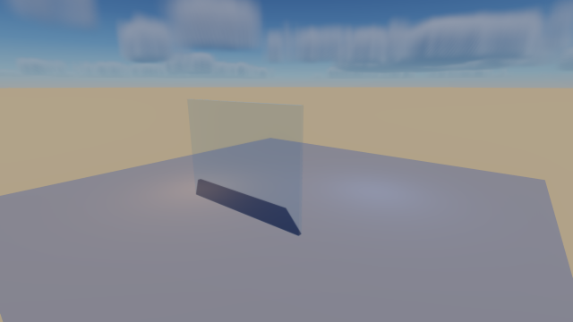
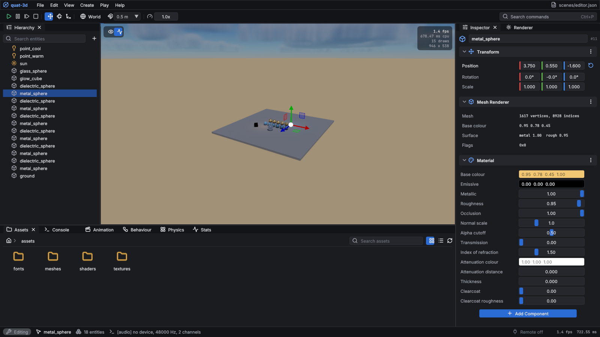

# quat-3d

[](https://github.com/tomerab1/quat-3d/actions/workflows/ci.yml)

quat-3d is a game engine and editor written in modern C++ (C++23). It renders
with Vulkan, loads standard glTF 2.0 models, simulates physics with Jolt, and
ships with an editor for building scenes. The long-term goal is an engine you
can ship real games with — including on Steam — and that AI assistants can
drive directly to build and debug worlds from a prompt.

> **Project status:** the core engine (rendering, animation, physics, terrain,
> NPCs, basic multiplayer, editor) works. Current work is a stability pass
> (bug audit, automated tests, CI), followed by AI tooling over the Model
> Context Protocol, macOS support, and audio. See [Roadmap](#roadmap) and
> [`docs/STATUS.md`](docs/STATUS.md) for what is in progress right now.

## Screenshots

Real engine output, rendered headless on a software Vulkan driver (lavapipe) by
the CI screenshot pipeline.

| Showcase (PBR materials, glass) | Terrain (GPU synthesis + GPU grass) | Physics |
|---|---|---|
|  |  |  |

The editor (dark theme; a light theme is one click away in View > Theme):



## What it can do today

**Rendering**
- Deferred physically based shading with clustered point lights (GPU light
  culling into view-space froxels, up to 4096 lights per frame)
- Sun shadows from four cascades fitted on the GPU to what the camera sees,
  stable under camera motion, with soft PCF / PCSS edges and screen-space
  contact shadows for small detail; meshes, instanced objects and terrain cast
- Ambient occlusion (GTAO) with bent normals that also darkens reflections in
  crevices; every shadow / AO setting is tunable in the editor's Renderer panel
- Glass and transparency (refraction, absorption, IOR), clearcoat car paint
- Physically based sky with volumetric clouds and a moving sun
- Image-based lighting that keeps up with the sky in real time
- Anti-aliasing (TAA), bloom, auto-exposure, filmic tonemapping
- Automatic instancing: objects sharing a mesh and material (trees, rocks,
  crates) are drawn together in one instanced draw

**Animation**
- Skeletal animation from glTF files, skinned on the GPU
- Blending between clips, additive layers, and a state machine
- Inertialized transitions (Gears of War style): switching clips evaluates
  only the new clip while the old pose's offset decays smoothly; crossfades
  remain available
- Foot IK: feet plant on uneven ground and slopes (physics raycasts or the
  terrain height) with the pelvis lowered to the lower foot
- Clips are compressed on load with ACL (the codec Unreal uses), within
  0.1 mm of the source animation

**World**
- Procedural terrain: seeded generation with erosion, level of detail, and
  seamless streaming for kilometre-scale worlds; tiles (noise + hydraulic /
  thermal erosion) are synthesised on the GPU in milliseconds, with the
  deterministic CPU generator as fallback and reference
- Dense, wind-animated grass generated on the GPU every frame around the
  camera (slope / height limits, distance level of detail, no popping)
- Jolt physics: rigid bodies, character controller, triggers, terrain collision

**Audio**
- miniaudio-based mixer with music / sfx / ui / ambience buses, 3D positional
  sound with distance falloff, streamed music (wav, flac, mp3)

**Gameplay**
- NPC navigation (Recast/Detour navmesh), path following, patrol routes
- Data-driven behaviour trees (JSON)
- Multiplayer foundations: client/server transport, state replication,
  client-side prediction

**Editor**
- Docked editor: viewport, hierarchy, inspector, asset browser, console,
  animation preview, behaviour-tree graph editor, physics and stats panels;
  the layout and preferences persist per project
- Dark and light themes (WCAG AA contrast), Inter + JetBrains Mono with Lucide
  icons, scaling with the display's DPI
- A command palette (Ctrl+P) over every action, one shortcut table (F1), a
  toolbar with play / pause / step / stop, move / rotate / scale gizmos in
  world or local space with snapping, and a status bar with frame timing,
  selection and the AI-tool (MCP) connection
- Inspector property grid with reset-to-default, coloured X/Y/Z fields and a
  searchable Add Component list; hierarchy search, type icons, rename,
  duplicate and drag-to-re-parent
- Save and load scenes as JSON; click-to-walk and patrol authoring for NPCs

## Platforms

| Platform | Status |
|---|---|
| Linux | Supported (primary development platform, built in CI) |
| Windows | Supported |
| macOS | Runs through MoltenVK (Vulkan on Metal) with a compatibility flag; full support is on the roadmap |

## Building

You need CMake 3.22+, Ninja, a C++23 compiler, the
[Vulkan SDK](https://vulkan.lunarg.com/) (for `slangc`, the shader compiler),
and [vcpkg](https://github.com/microsoft/vcpkg). vcpkg downloads and builds
every C++ library the engine uses the first time you configure — expect that
first configure to take a while; later ones are fast.

Set up vcpkg once (the build expects it at `~/vcpkg`, or `%USERPROFILE%\vcpkg`
on Windows):

```sh
git clone https://github.com/microsoft/vcpkg.git ~/vcpkg
~/vcpkg/bootstrap-vcpkg.sh -disableMetrics      # bootstrap-vcpkg.bat on Windows
```

### Linux

```sh
sudo apt install clang libc++-dev libc++abi-dev cmake ninja-build pkg-config \
     libx11-dev libxext-dev libxft-dev libxcursor-dev libxrandr-dev libxi-dev \
     libxss-dev libxtst-dev libxfixes-dev libxkbcommon-dev \
     libwayland-dev wayland-protocols libegl-dev libdecor-0-dev   # SDL3 X11/Wayland
# install the Vulkan SDK (or just slangc) and make sure `slangc` is on PATH

cmake --preset release
cmake --build --preset release
./build/release/game
```

### Windows

Install Visual Studio 2022 (Desktop C++ workload), the Vulkan SDK, CMake and
Ninja, then run:

```bat
scripts\build-windows-release.bat
```

or use the `windows-release` CMake preset from a Visual Studio developer prompt.

### macOS (Apple Silicon)

Install the Xcode command-line tools, `brew install cmake ninja`, and the macOS
Vulkan SDK (it includes MoltenVK). MoltenVK lacks one Vulkan feature the engine
normally uses, so the build turns on a compatibility path:

```sh
export VULKAN_SDK=$HOME/VulkanSDK/<version>/macOS
export PATH="$VULKAN_SDK/bin:$PATH"

cmake -S . -B build/macos -G Ninja \
  -DCMAKE_BUILD_TYPE=Release \
  -DENGINE_DESCRIPTOR_SETS_FALLBACK=ON \
  -DCMAKE_TOOLCHAIN_FILE=$HOME/vcpkg/scripts/buildsystems/vcpkg.cmake
cmake --build build/macos
./build/macos/game
```

### Graphics driver requirements

A Vulkan 1.3 driver with dynamic rendering, synchronization2 and buffer device
addresses, plus `VK_EXT_descriptor_buffer` (any recent NVIDIA, AMD or Intel
driver, or Mesa) — or a build with `ENGINE_DESCRIPTOR_SETS_FALLBACK=ON`.

## Running

`./build/release/game` opens the editor with a showcase scene. Hold the right
mouse button in the viewport and use WASD to fly; W/E/R switch the gizmo
between move, rotate and scale, X toggles world/local space and Y snapping.
F5 plays, F6 pauses, F10 steps one frame, Shift+F5 stops. Ctrl+P opens the
command palette and F1 lists every shortcut. The layout and editor
preferences are saved to `.quat/editor.ini` in the project root (View >
Reset Layout restores the default).

Environment variables switch on extra modes:

| Variable | Effect |
|---|---|
| `QUAT_GLTF=<file>` | Load a glTF/GLB model instead of the showcase scene |
| `QUAT_TERRAIN=1` | Add a procedural terrain tile (with a grass field) |
| `QUAT_PHYSICS=1` / `QUAT_CHARACTER=1` | Physics / character-controller demo scenes |
| `QUAT_HOST=<port>` / `QUAT_JOIN=<ip:port>` | Host or join a networked session |
| `QUAT_REMOTE=<port>` | Open the remote-control endpoint for AI tools (`1` = port 7878); add `QUAT_REMOTE_TOKEN=<secret>` to require a token — see [`docs/remote-control.md`](docs/remote-control.md) |
| `QUAT_LOG_CAPTURE=0` | Do not tee stderr into the engine log that the editor Console and the AI debugging tools (`debug.log`) read |
| `QUAT_SHADER_HOT_RELOAD=0` / `=1` | Turn shader hot reload off (on by default in editor builds) or on (in non-editor builds): saving a `.slang` file under `assets/shaders/` recompiles it and swaps the pipelines in — see [`docs/DEVELOPMENT.md`](docs/DEVELOPMENT.md#shader-hot-reload) |
| `QUAT_SLANGC=<path>` | The `slangc` hot reload compiles with (default: the one the build used, else `PATH`) |
| `QUAT_NO_UI=1` | Run without the editor UI |
| `QUAT_EDITOR_THEME=light` | Start the editor in the light theme |
| `QUAT_EDITOR_LAYOUT=default` | Start from the default layout and do not save it (captures, tests) |
| `QUAT_EDITOR_SELECT=<name>` / `QUAT_EDITOR_FOCUS=<panel>` | Select an entity / bring a panel forward at startup (`scripts/editor-screenshots.sh`) |
| `QUAT_WINDOW_SIZE=<w>x<h>` | Initial window size (default 1280x720) |
| `QUAT_NO_VSYNC=1` | Disable vsync |
| `QUAT_NO_AUDIO=1` | Mute: run audio without opening a playback device |
| `QUAT_MAX_FRAMES=<n>` + `QUAT_SCREENSHOT=<file.ppm>` | Render n frames, save the last one, exit (headless checks) |

### Audio

Give an entity an **Audio Source** (Inspector → Add component) and set its
`clip` to a `.wav`, `.flac` or `.mp3` path relative to the project root (e.g.
`assets/audio/fire.wav`). Pick a bus (`music` and `ambience` stream from disk;
`sfx` and `ui` load into memory), then volume, pitch and looping. A **3D**
source plays from the entity's position: full volume within `min distance`,
fading with distance (`rolloff`) until `max distance`. Sources with
`play on start` begin when you press Play; the inspector's Play / Pause / Stop
buttons audition a clip without entering Play mode. Sound is heard from the
camera, or from the entity carrying an active **Audio Listener** (e.g. the
player). From scripts and AI tools, set `audio_source.command` to `play`,
`stop`, `pause` or `resume`.

### Sample models

Put glTF models under `sample-assets/` (not committed) and they show up in the
editor's asset browser — double-click one, or drag it into the viewport. The
[Khronos glTF sample models](https://github.com/KhronosGroup/glTF-Sample-Assets)
work well, e.g. `DamagedHelmet`, `CarConcept`, and the animated `Fox`:

```sh
git clone --filter=blob:none --sparse --depth 1 \
  https://github.com/KhronosGroup/glTF-Sample-Assets.git /tmp/gltf-samples
cd /tmp/gltf-samples && git sparse-checkout set Models/Fox Models/ToyCar
cp -R Models/Fox/glTF ~/quat-3d/sample-assets/Fox
```

## AI tools (MCP)

[`tools/quat-mcp`](tools/quat-mcp/README.md) is an MCP server that lets AI
assistants such as Claude Code and Claude Desktop build and inspect worlds in
the running engine — create entities, set the sky and camera, take
screenshots, spawn models — and debug it: read the engine log and Vulkan
validation messages, frame statistics, pause / single-step / slow down the
simulation, watch entities, cast physics rays and query navmesh paths — and
tune the look: exposure, bloom, anti-aliasing, shadows, sky light, clouds and
per-entity materials, with the same values the editor's Renderer panel and
Material inspector show — and author NPC behaviour trees: build, inspect and
edit the same graph the editor's Behaviour panel shows, with per-node
validation errors, and see what each node did on the last tick. Start the
engine with `QUAT_REMOTE=7878`, build the
server with `cargo build --release` in `tools/quat-mcp`, and register it with
your client:

```sh
claude mcp add quat-3d --env QUAT_REMOTE_PORT=7878 -- "$PWD/tools/quat-mcp/target/release/quat-mcp"
```

See [`tools/quat-mcp/README.md`](tools/quat-mcp/README.md) for Claude Desktop
setup, tokens and the full tool list.

## Testing

Tests use [GoogleTest](https://github.com/google/googletest) and run without
a window through `engine_tests`:

```sh
ctest --test-dir build/release --output-on-failure      # everything
./build/release/engine_tests --gtest_filter='-Gpu*'     # only tests that need no GPU
./build/release/engine_tests --gtest_filter='Physics.*' # one suite
./build/release/engine_tests --gtest_list_tests         # list all tests
```

GPU tests run on any Vulkan device; without a GPU, Mesa's software driver
(lavapipe) works — that is what CI uses. Every push is built and tested on
Linux by [GitHub Actions](.github/workflows/ci.yml).

## Roadmap

The plan lives in [`ROADMAP.md`](ROADMAP.md), grouped into tracks:

1. **Stability** *(now)* — bug audit, hardened file/network input, automated tests, CI on all platforms
2. **AI tooling** — a Rust [MCP](https://modelcontextprotocol.io) server so AI
   assistants can build worlds, write shaders, author behaviours and debug the
   running engine
3. **Rendering & performance** — async loading, hot reload, GPU-driven rendering, profiling
4. **Platforms & shipping** — macOS, a path to a native Metal backend, Steamworks, game packaging
5. **Gameplay** — audio (miniaudio), visual node editors for behaviour and shaders, more networking
6. **Editor** — undo/redo, prefabs, project and asset management

## Documentation

| Document | What it covers |
|---|---|
| [`docs/STATUS.md`](docs/STATUS.md) | What is in progress, what is blocked, what comes next |
| [`docs/DEVELOPMENT.md`](docs/DEVELOPMENT.md) | Building, testing, CI, and conventions for contributors |
| [`docs/remote-control.md`](docs/remote-control.md) | The remote-control protocol AI tools use to drive the engine |
| [`docs/editor-ux.md`](docs/editor-ux.md) | The editor's design system: principles, tokens, widget kit, layout, shortcuts |
| [`docs/CYCLE.md`](docs/CYCLE.md) | How development runs: the repeating plan → parallel agents → merge → CI → audit → learn cycle |
| [`docs/LEARNINGS.md`](docs/LEARNINGS.md) | Lessons recorded by past cycles |
| [`ROADMAP.md`](ROADMAP.md) | The full plan, with completed history |
| [`CLAUDE.md`](CLAUDE.md) | Architecture rules and coding conventions |

## Repository layout

```
assets/shaders/     Slang shader sources (compiled into cooked/shaders/ during the build)
include/engine/     Public headers, one folder per module
src/                Implementation, mirroring include/ (rhi, renderer, scene, physics, ...)
src/editor/         The editor (only in builds with ENGINE_EDITOR=ON, the default)
src/remote/         Remote-control endpoint used by AI tooling
tools/quat-mcp/     MCP server for AI assistants (Rust, standalone Cargo crate)
tests/              GoogleTest suite (engine_tests): tests/<module>/, shared helpers in tests/support/
docs/               Project documentation
ports/, triplets/   vcpkg customisations
```

## Tech stack

Vulkan 1.3 · Slang · SDL3 · Jolt Physics · EnTT · fastgltf · glm · Dear ImGui +
ImGuizmo · Vulkan Memory Allocator · Recast/Detour · GameNetworkingSockets ·
nlohmann/json · CMake + vcpkg
