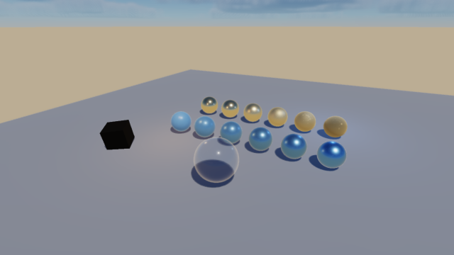
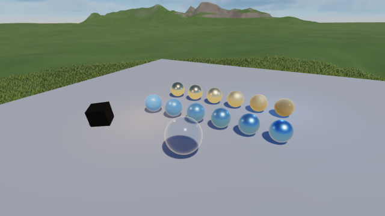
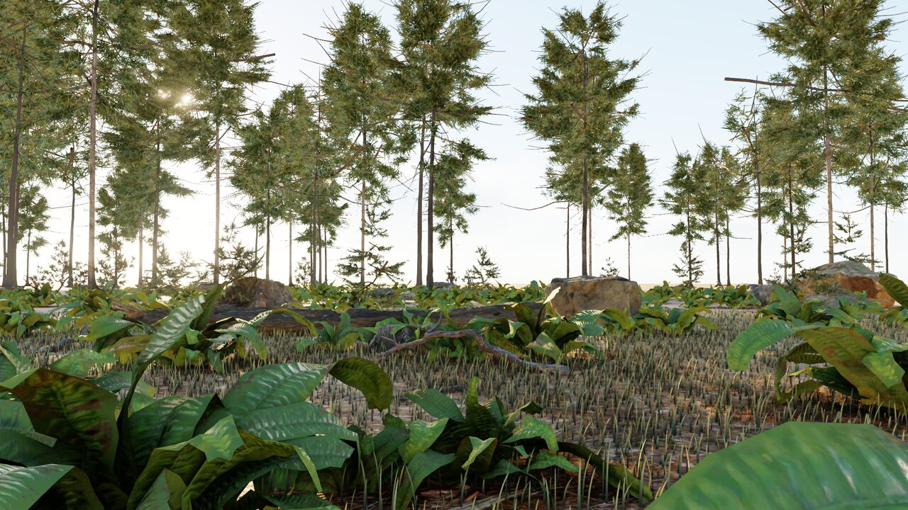

# quat-3d

[](https://github.com/tomerab1/quat-3d/actions/workflows/ci.yml)

quat-3d is a game engine and editor written in modern C++ (C++23). It renders
with Vulkan, loads standard glTF 2.0 models, simulates physics with Jolt, and
ships with an editor for building scenes. The long-term goal is an engine you
can ship real games with — including on Steam — and that AI assistants can
drive directly to build and debug worlds from a prompt.

> **Project status:** the core engine (rendering, animation, physics, terrain,
> NPCs, basic multiplayer, editor) works. Current work is a stability pass
> (bug audit, automated tests, CI), followed by AI tooling over the Model
> Context Protocol, macOS support, and audio. See [Roadmap](#roadmap) and
> [`docs/STATUS.md`](docs/STATUS.md) for what is in progress right now.

## Screenshots

Real engine output, rendered headless on a software Vulkan driver (lavapipe) by
the CI screenshot pipeline.

| Showcase (PBR materials, glass) | Terrain (GPU synthesis + GPU grass) | Physics |
|---|---|---|
|  |  |  |

The editor (dark theme; a light theme is one click away in View > Theme):


## What it can do today

**Rendering**
- Deferred physically based shading with clustered point lights (GPU light
  culling into view-space froxels, up to 4096 lights per frame)
- Sun shadows from four cascades fitted on the GPU to what the camera sees,
  stable under camera motion, with soft PCF / PCSS edges and screen-space
  contact shadows for small detail; meshes, instanced objects and terrain cast
- Ambient occlusion (GTAO) with bent normals that also darkens reflections in
  crevices; every shadow / AO setting is tunable in the editor's Renderer panel
- Glass and transparency (refraction, absorption, IOR), clearcoat car paint;
  glass and see-through materials cast soft, coloured shadows instead of
  black ones
- Alpha-cut materials (glTF `MASK`: leaves, grass cards, fences) cut holes in
  the surface and in its shadow, and keep their shape at a distance
  (coverage-preserving mipmaps); double-sided leaves are lit on both sides
- Physically based sky with volumetric clouds and a moving sun
- Weather: wind, cloud cover, rain or snow, wet ground and snow cover, set
  in the editor's Renderer panel, saved with the scene, and scriptable over
  MCP. Wet surfaces darken and turn glossy, with puddles on flat ground; snow
  settles on upward-facing surfaces and lowers the terrain's snowline; the
  clouds cast moving shadows (a cloud shadow map computed on the GPU). With
  accumulation on, rain soaks the ground, snow settles in the cold and melts
  in the warm, and the ground slowly dries.
- Image-based lighting that keeps up with the sky in real time
- Temporal anti-aliasing and upscaling (TAAU) with per-object motion vectors for
  moving, skinned, instanced and wind-animated geometry; render scale modes
  (native, quality, balanced, performance), set like every other render
  setting from the Renderer panel, `render.settings.*` / MCP or a scene file
- Bloom, auto-exposure, filmic tonemapping
- Automatic instancing: objects sharing a mesh and material (trees, rocks,
  crates) are drawn together in one instanced draw
- GPU particles for sparks, fire, smoke and dust: simulated in compute
  shaders (collisions with what the camera sees), soft edges, flipbook
  animation, lit by the sun and point lights, order-independent transparency
  for smoke; emitters are plain components, so AI tools can author them
- GPU-compressed textures: KTX2 / Basis Universal textures (glTF
  `KHR_texture_basisu` or loose `.ktx2`) are transcoded at load to BC7 / BC5 /
  BC4 on desktop GPUs, ASTC on Apple GPUs, or plain RGBA8 elsewhere
- Compressed meshes: glTF `EXT_meshopt_compression` and `KHR_mesh_quantization`

**Animation**
- Skeletal animation from glTF files, skinned on the GPU
- Blending between clips, additive layers, and a state machine
- Inertialized transitions (Gears of War style): switching clips evaluates
  only the new clip while the old pose's offset decays smoothly; crossfades
  remain available
- Foot IK: feet plant on uneven ground and slopes (physics raycasts or the
  terrain height) with the pelvis lowered to the lower foot
- Clips are compressed on load with ACL (the codec Unreal uses), within
  0.1 mm of the source animation

**World**
- Procedural terrain: seeded generation with erosion, level of detail, and
  seamless streaming for kilometre-scale worlds; tiles (noise + hydraulic /
  thermal erosion, with steep faces relaxed to the talus angle by a multigrid
  solver) are synthesised on the GPU in milliseconds, with the deterministic
  CPU generator as fallback and reference; one memory budget bounds the
  resolution x streaming radius of a world
- Dense grass generated on the GPU every frame around the camera (slope /
  height limits, distance level of detail, no popping); with weather it bends
  in a global wind field computed on the GPU: gust fronts sweep across the
  field and eddies swirl through it
- Jolt physics: rigid bodies, character controller, triggers, terrain collision

**Audio**
- miniaudio-based mixer with music / sfx / ui / ambience buses, 3D positional
  sound with distance falloff, streamed music (wav, flac, mp3)

**Gameplay**
- Lua 5.4 gameplay scripting: per-entity scripts with start / update /
  trigger / destroy callbacks, an API for entities, components, physics,
  input (keyboard, mouse, gamepad), audio and navigation, sandboxed with
  per-call time and memory limits, hot-reloaded on save — see
  [`docs/scripting.md`](docs/scripting.md)
- NPC navigation (Recast/Detour navmesh), path following, patrol routes
- Data-driven behaviour trees (JSON)
- Multiplayer foundations: client/server transport, state replication,
  client-side prediction

**Editor**
- Docked editor: viewport, hierarchy, inspector, asset browser, console,
  animation preview, behaviour-tree graph editor, physics and stats panels;
  the layout and preferences persist per project
- Dark and light themes (WCAG AA contrast), Inter + JetBrains Mono with Lucide
  icons, scaling with the display's DPI
- A command palette (Ctrl+P) over every action, one shortcut table (F1), a
  toolbar with play / pause / step / stop, move / rotate / scale gizmos in
  world or local space with snapping, and a status bar with frame timing,
  selection and the AI-tool (MCP) connection
- Inspector property grid with reset-to-default, coloured X/Y/Z fields and a
  searchable Add Component list; hierarchy search, type icons, rename,
  duplicate and drag-to-re-parent
- Save and load scenes as JSON; click-to-walk and patrol authoring for NPCs

## Platforms

Every push to `master` and every pull request is built and tested on all
three platforms (see [`.github/workflows/ci.yml`](.github/workflows/ci.yml)):

| Platform | Status | CI |
|---|---|---|
| Linux | Supported (primary development platform) | clang + libc++, CPU and GPU tests on Mesa lavapipe |
| Windows | Supported | MSVC 2022, CPU and GPU tests on Mesa lavapipe |
| macOS (Apple Silicon) | Runs through MoltenVK (Vulkan on Metal) with the descriptor-set compatibility path; native Metal is on the roadmap | Apple clang, CPU tests; GPU tests on MoltenVK (informational) |

## Download a build

Ready-to-run builds are attached to each
[GitHub Release](../../releases) (built and smoke-tested by
[`.github/workflows/release.yml`](.github/workflows/release.yml) for every
`v*` tag). Every archive contains a `README-RUN.txt` with the launch options
and troubleshooting.

| Download | Run |
|---|---|
| `quat-3d-<version>-linux-x64.tar.gz` | `tar xzf quat-3d-*-linux-x64.tar.gz && ./quat-3d-*/game`. Needs the system Vulkan loader and a Vulkan 1.3 driver (Mesa or NVIDIA; `sudo apt install libvulkan1 mesa-vulkan-drivers`); the C++ runtime ships in `lib/`. Built on Ubuntu 24.04: needs glibc 2.39+ (Ubuntu 24.04, Debian 13, Fedora 40 or newer). |
| `quat-3d-<version>-windows-x64.zip` | Unzip, run `game.exe`. Needs a current GPU driver (it provides `vulkan-1.dll`); the libraries and MSVC runtime are in the folder. The build is not code-signed: SmartScreen → *More info* → *Run anyway*. |
| `quat-3d-<version>-macos-arm64.zip` | Unzip and double-click `Quat3D.app`. The app is ad-hoc signed but not notarized (signing is ROADMAP P7), so Gatekeeper blocks the first launch: dismiss the dialog, then **System Settings → Privacy & Security → *Open Anyway*** (macOS 15+; on macOS 14 right-click → Open also works) — or run `xattr -dr com.apple.quarantine Quat3D.app` once. MoltenVK and the Vulkan loader are inside the app. Apple Silicon, macOS 15 or later today (the bundled Vulkan libraries come from Homebrew; the engine itself targets macOS 14). |

Environment variables (see [Running](#running)) work with the packaged game
too; on macOS launch `Quat3D.app/Contents/MacOS/game` from Terminal to set
them. The game looks for its data (`assets/`, `cooked/shaders/`) next to the
executable — or in `QUAT_ASSET_ROOT` — so keep the unpacked folder together.

## Building

You need CMake 3.22+, Ninja, a C++23 compiler, `slangc` (the
[Slang](https://github.com/shader-slang/slang/releases) shader compiler — CI
uses Slang 2025.6.1; the [Vulkan SDK](https://vulkan.lunarg.com/) also ships
one), and [vcpkg](https://github.com/microsoft/vcpkg). vcpkg downloads and
builds every C++ library the engine uses the first time you configure — expect
that first configure to take a while (roughly 15–30 minutes); later ones are fast.

Set up vcpkg once (the build expects it at `~/vcpkg`, or `%USERPROFILE%\vcpkg`
on Windows; CI pins it to the manifest's `builtin-baseline`):

```sh
git clone https://github.com/microsoft/vcpkg.git ~/vcpkg
~/vcpkg/bootstrap-vcpkg.sh -disableMetrics      # bootstrap-vcpkg.bat on Windows
```

Every preset builds the engine, the `game` executable and the `engine_tests`
suite; run the tests with `ctest --test-dir build/<preset> --output-on-failure`
(see [`docs/DEVELOPMENT.md`](docs/DEVELOPMENT.md#testing)).

### Linux

```sh
sudo apt install clang libc++-dev libc++abi-dev cmake ninja-build pkg-config \
     libx11-dev libxext-dev libxft-dev libxcursor-dev libxrandr-dev libxi-dev \
     libxss-dev libxtst-dev libxfixes-dev libxkbcommon-dev \
     libwayland-dev wayland-protocols libegl-dev libdecor-0-dev \
     libvulkan-dev autoconf automake libtool                     # SDL3 X11/Wayland, ports
# put `slangc` on PATH (Vulkan SDK or a Slang release)

cmake --preset release
cmake --build --preset release
./build/release/game
```

### Windows

Install Visual Studio 2022 (Desktop C++ workload — it includes CMake and
Ninja) and the [Vulkan SDK](https://vulkan.lunarg.com/) (headers, loader and
`slangc`; CI uses 1.4.321.1), then from a plain shell run:

```bat
scripts\build-windows-release.bat
```

or, from a Visual Studio x64 developer prompt (MSVC must be the active
compiler — the preset pins `cl`):

```bat
cmake --preset windows-release
cmake --build --preset windows-release
build\windows-release\game.exe
```

vcpkg's `x64-windows` triplet builds the dependencies as DLLs; the build copies
them next to `game.exe` and `engine_tests.exe`.

### macOS (Apple Silicon)

Install the Xcode command-line tools and, with Homebrew, the build tools and
Vulkan-on-Metal (the Vulkan loader plus the MoltenVK driver). Get `slangc` from
a [Slang release](https://github.com/shader-slang/slang/releases)
(`slang-<version>-macos-aarch64.tar.gz`) or the macOS Vulkan SDK:

```sh
brew install cmake ninja pkgconf molten-vk vulkan-loader vulkan-headers vulkan-tools
export VULKAN_SDK=$(brew --prefix)      # lets CMake find the Vulkan headers/loader
export PATH="$HOME/slang/bin:$PATH"     # wherever slangc lives

cmake --preset macos-release
cmake --build --preset macos-release
./build/macos-release/game
```

MoltenVK lacks `VK_EXT_descriptor_buffer`, so the `macos-release` preset turns
on `ENGINE_DESCRIPTOR_SETS_FALLBACK` (classic descriptor sets + portability
enumeration). It also pins macOS 14 as the minimum for the engine and every
vcpkg port (the `arm64-osx-14` overlay triplet in `triplets/` — Apple clang
already uses libc++, so nothing else differs from vcpkg's stock triplet).
With the LunarG macOS Vulkan SDK
instead of Homebrew, set `VULKAN_SDK=$HOME/VulkanSDK/<version>/macOS`.

### Graphics driver requirements

A Vulkan 1.3 driver with dynamic rendering, synchronization2 and buffer device
addresses, plus `VK_EXT_descriptor_buffer` (any recent NVIDIA, AMD or Intel
driver, or Mesa) — or a build with `ENGINE_DESCRIPTOR_SETS_FALLBACK=ON`.

## Running

`./build/release/game` opens the editor with a showcase scene. Hold the right
mouse button in the viewport and use WASD to fly; W/E/R switch the gizmo
between move, rotate and scale, X toggles world/local space and Y snapping.
F5 plays, F6 pauses, F10 steps one frame, Shift+F5 stops. Ctrl+P opens the
command palette and F1 lists every shortcut. The layout and editor
preferences are saved to `.quat/editor.ini` in the project root (View >
Reset Layout restores the default).

Environment variables switch on extra modes:

| Variable | Effect |
|---|---|
| `QUAT_SCENE=<file>` | Load a scene file (project-relative) instead of the showcase scene |
| `QUAT_PLAY=1` | Enter Play mode on the first frame (a non-editor build also plays a `QUAT_SCENE` game) |
| `QUAT_GAME_CAMERA=1` | Editor builds: Play looks through the scene's active camera from the start ("Game camera"), e.g. for a scene's hero shot |
| `QUAT_SCRIPT_HOT_RELOAD=0` / `=1` | Turn script hot reload off (editor) / on (non-editor builds) |
| `QUAT_GLTF=<file>` | Load a glTF/GLB model instead of the showcase scene |
| `QUAT_TERRAIN=1` | Add a procedural terrain tile (with a grass field) |
| `QUAT_PHYSICS=1` / `QUAT_CHARACTER=1` | Physics (with sparks and smoke) / character-controller demo scenes |
| `QUAT_HOST=<port>` / `QUAT_JOIN=<ip:port>` | Host or join a networked session (host listens on 127.0.0.1 only unless `QUAT_NET_BIND` says otherwise) — see [Networking](#networking) |
| `QUAT_NET_BIND=<ipv4>` | Host: interface to listen on (default `127.0.0.1`; `0.0.0.0` = every interface, for LAN/internet play) |
| `QUAT_NET_MAX_CLIENTS=<n>` | Host: connections held at once (default 8, max 1024); more are refused as "server full" |
| `QUAT_NET_TOKEN=<secret>` | Host: join token every client must present; client: the token it presents |
| `QUAT_NET_OWNER_TOKEN=<secret>` | Host: only a client presenting this token (as its `QUAT_NET_TOKEN`) controls the player character |
| `QUAT_REMOTE=<port>` | Open the remote-control endpoint for AI tools (`1` = port 7878). It always requires a session token: a random one per run, written to a file only you can read, where quat-mcp finds it — see [`docs/remote-control.md`](docs/remote-control.md#session-token) |
| `QUAT_REMOTE_TOKEN=<secret>` / `QUAT_REMOTE_TOKEN_FILE=<path>` | With `QUAT_REMOTE`: use this token instead of a generated one / publish the token at this path instead of the per-user default |
| `QUAT_LOG_CAPTURE=0` | Do not tee stderr into the engine log that the editor Console and the AI debugging tools (`debug.log`) read |
| `QUAT_SHADER_HOT_RELOAD=0` / `=1` | Turn shader hot reload off (on by default in editor builds) or on (in non-editor builds): saving a `.slang` file under `assets/shaders/` recompiles it and swaps the pipelines in — see [`docs/DEVELOPMENT.md`](docs/DEVELOPMENT.md#shader-hot-reload) |
| `QUAT_SLANGC=<path>` | The `slangc` hot reload compiles with (default: the one the build used, else `PATH`) |
| `QUAT_NO_UI=1` | Run without the editor UI |
| `QUAT_EDITOR_THEME=light` | Start the editor in the light theme |
| `QUAT_EDITOR_LAYOUT=default` | Start from the default layout and do not save it (captures, tests) |
| `QUAT_EDITOR_SELECT=<name>` / `QUAT_EDITOR_FOCUS=<panel>` | Select an entity / bring a panel forward at startup (`scripts/editor-screenshots.sh`) |
| `QUAT_WINDOW_SIZE=<w>x<h>` | Initial window size (default 1280x720) |
| `QUAT_NO_VSYNC=1` | Disable vsync |
| `QUAT_NO_MUTABLE_SWAPCHAIN=1` | Act as a driver without `VK_KHR_swapchain_mutable_format`: the editor UI composites through a scratch image and a copy instead of a UNORM view of the swapchain (same pixels; for checking that fallback) |
| `QUAT_NO_AUDIO=1` | Mute: run audio without opening a playback device |
| `QUAT_NON_FINITE_CHECK=1` | Count NaN/Inf values the bloom / TAA guards replace and log them per frame (always on in debug builds) |
| `QUAT_MAX_FRAMES=<n>` + `QUAT_SCREENSHOT=<file.ppm>` | Render n frames, save the last one, exit (headless checks) |
| `QUAT_ASSET_ROOT=<dir>` | Data directory holding `assets/` and `cooked/shaders/` (default: next to the executable — inside a macOS app, `Contents/Resources` — then, in development builds, the source tree) |

### Networking

One machine hosts, others join it with the same scene; the host simulates and
replicates, and the joined player's character is predicted locally.

```sh
# Same machine (the host only listens on 127.0.0.1 by default)
QUAT_HOST=27015 ./build/release/game
QUAT_JOIN=127.0.0.1:27015 ./build/release/game

# Over a LAN / the internet: opt in to every interface and set a token
QUAT_HOST=27015 QUAT_NET_BIND=0.0.0.0 QUAT_NET_TOKEN=letmein ./build/release/game
QUAT_JOIN=192.168.1.20:27015 QUAT_NET_TOKEN=letmein ./build/release/game
```

What the host enforces:

- **Bind address:** loopback unless `QUAT_NET_BIND` names another IPv4
  interface. A host bound beyond loopback without a token logs a warning.
- **Connection cap:** at most `QUAT_NET_MAX_CLIENTS` connections (default 8),
  counting ones still handshaking; extra ones are refused as "server full".
- **Join handshake:** a client's first message is a hello carrying the
  protocol version and `QUAT_NET_TOKEN`. Until it arrives the client gets no
  snapshots and cannot control anything. A wrong token, a version mismatch or
  any other first message disconnects it, and so does staying silent for 5 s.
- **Player control:** the player character goes to the first client to
  authenticate (not to whoever sends input first). With
  `QUAT_NET_OWNER_TOKEN` set, only a client presenting that token gets it;
  others watch. When the controlling client leaves, the next eligible client
  that authenticated takes over.
- **Rate limits:** each client may send 1000 messages and 64 KiB per second
  (2 s of burst); a client above either is disconnected. Clients send one
  input per frame, so this also caps a joined client's useful frame rate.

A refused or dropped client logs the reason (`server full`, `authentication
failed`, `authentication timed out`, `rate limited`). The limits are fields of
`engine::net::HostConfig` (`include/engine/net/session_config.hpp`,
`host_access.hpp`) for code that hosts through `NetSession::host`.

### Audio

Give an entity an **Audio Source** (Inspector → Add component) and set its
`clip` to a `.wav`, `.flac` or `.mp3` path relative to the project root (e.g.
`assets/audio/fire.wav`). Pick a bus (`music` and `ambience` stream from disk;
`sfx` and `ui` load into memory), then volume, pitch and looping. A **3D**
source plays from the entity's position: full volume within `min distance`,
fading with distance (`rolloff`) until `max distance`. Sources with
`play on start` begin when you press Play; the inspector's Play / Pause / Stop
buttons audition a clip without entering Play mode. Sound is heard from the
camera, or from the entity carrying an active **Audio Listener** (e.g. the
player). From scripts and AI tools, set `audio_source.command` to `play`,
`stop`, `pause` or `resume`.

### Scripting

Gameplay is written in Lua: put a script under `assets/scripts/`, give an
entity a **Script** component (Inspector → Add component) and pick the file;
it runs when you press Play and reloads whenever you save it. The inspector
lists the script's declared properties so each entity can tune them, and
*Stats → Scripts* shows errors with their line. Try the bundled demo:

```sh
QUAT_SCENE=assets/scenes/coin_collector.json QUAT_PLAY=1 ./build/release/game
```

The language reference, callbacks and the whole engine API are in
[`docs/scripting.md`](docs/scripting.md). AI assistants can write and debug
scripts through MCP (`script_*` tools and the `write-gameplay-script` skill).

### Cinematic showcase (CC0 Poly Haven assets)

`assets/scenes/cinematic_forest.json` is a pine-forest clearing at golden
hour built from real downloaded CC0 models, textures and an HDRI from
[Poly Haven](https://polyhaven.com). The assets are not committed; fetch
and cook them first (about 560 MB, checksums verified), then run it:

```sh
python3 scripts/fetch-polyhaven.py assets/showcase/cinematic/assets.json \
  --cook-with build/release/quat-cook
QUAT_SCENE=assets/scenes/cinematic_forest.json QUAT_PLAY=1 QUAT_GAME_CAMERA=1 ./build/release/game
```



The assets, credits, stills and the MCP recipe for building scenes like it
are in [`docs/cinematic-showcase.md`](docs/cinematic-showcase.md).

### Sample models

Put glTF models under `sample-assets/` (not committed) and they show up in the
editor's asset browser — double-click one, or drag it into the viewport. The
[Khronos glTF sample models](https://github.com/KhronosGroup/glTF-Sample-Assets)
work well, e.g. `DamagedHelmet`, `CarConcept`, and the animated `Fox`:

```sh
git clone --filter=blob:none --sparse --depth 1 \
  https://github.com/KhronosGroup/glTF-Sample-Assets.git /tmp/gltf-samples
cd /tmp/gltf-samples && git sparse-checkout set Models/Fox Models/ToyCar
cp -R Models/Fox/glTF ~/quat-3d/sample-assets/Fox
```

### Cooking assets for shipping

`quat-cook` (built with the engine) rewrites a glTF for release: textures
become KTX2 / Basis Universal with mip chains, meshes are reordered for the
GPU caches, quantised and compressed with meshoptimizer. A cooked model loads
faster and needs about a quarter of the texture memory:

```sh
./build/release/quat-cook sample-assets/DamagedHelmet.glb sample-assets/DamagedHelmet.cooked.glb
```

Cooked files are meant for the engine: normal maps are stored in a two-channel
layout other glTF viewers do not expect (`--normal-layout rgb` avoids that).
Options (codecs, quality) are listed in
[`docs/DEVELOPMENT.md`](docs/DEVELOPMENT.md#cooking-assets).

## AI tools (MCP)

[`tools/quat-mcp`](tools/quat-mcp/README.md) is an MCP server that lets AI
assistants such as Claude Code and Claude Desktop build and inspect worlds in
the running engine — create entities, set the sky and camera, take
screenshots, spawn models — and debug it: read the engine log and Vulkan
validation messages, frame statistics, pause / single-step / slow down the
simulation, watch entities, cast physics rays and query navmesh paths — and
tune the look: exposure, bloom, anti-aliasing, shadows, sky light, clouds and
per-entity materials, with the same values the editor's Renderer panel and
Material inspector show — set the weather (wind, clouds, rain or snow,
wetness, snow cover) — author NPC behaviour trees: build, inspect and
edit the same graph the editor's Behaviour panel shows, with per-node
validation errors, and see what each node did on the last tick — and write
material shaders: Slang modules the engine compiles (returning the compiler
errors with line numbers), assigns to entities and hot-swaps while it runs.
For world building it reports entity bounds, sets models down on terrain or
colliders (`world_place_on_ground`), takes screenshots from any camera without
moving yours, and searches and downloads CC0 models from Poly Haven
(`asset_search` / `asset_fetch`, into the gitignored `assets/meshes/polyhaven/`).
Physics in a running game: read and set body velocities, push
bodies with impulses and forces, change the scene's gravity, query every hit
along a ray, overlaps and shape casts, follow a feed of contact and trigger
events, author joints (hinges, sliders, distance ropes …) and walk character
controllers.

It also ships **workflow skills** — step-by-step guides with verification
steps and pitfalls for building a level, tuning the look, authoring
materials, writing gameplay scripts, designing NPC behaviour, debugging
physics glitches and playtesting. They are
[Agent Skills](https://agentskills.io) served over the MCP skills extension,
and the same guides are MCP prompts for clients without skills support.

Start the engine with `QUAT_REMOTE=7878` and install the server:

- **Claude Code** — the quat-3d plugin from this repository's marketplace
  registers quat-mcp and installs the skills. Build and install the server,
  then add the plugin:

  ```sh
  cargo install --path tools/quat-mcp
  ```

  ```
  /plugin marketplace add tomerab1/quat-3d
  /plugin install quat-3d@quat-3d
  ```

  The skills appear as `/quat-3d:build-level`, `/quat-3d:tune-look` and so
  on, and Claude picks them up by itself when a task matches.
- **Any other MCP client** — build the server with `cargo build --release`
  in `tools/quat-mcp` and register the binary; for example, without the
  plugin in Claude Code:

  ```sh
  claude mcp add quat-3d --env QUAT_REMOTE_PORT=7878 -- "$PWD/tools/quat-mcp/target/release/quat-mcp"
  ```

  Clients with skills support load the workflows as skills; the others list
  them as prompts (`build-level`, `tune-look`, ...).

No token setup is needed: the engine writes a fresh session token for each run
to a file only your user can read, and quat-mcp reads it from there. The
endpoint listens on `127.0.0.1` only and refuses connections without the
token, so other users on the machine and web pages in your browser cannot
drive the engine. See [`tools/quat-mcp/README.md`](tools/quat-mcp/README.md)
for Claude Desktop setup, explicit tokens, the full tool list and the workflows.

## Testing

Tests use [GoogleTest](https://github.com/google/googletest) and run without
a window through `engine_tests`:

```sh
ctest --test-dir build/release --output-on-failure      # everything
./build/release/engine_tests --gtest_filter='-Gpu*'     # only tests that need no GPU
./build/release/engine_tests --gtest_filter='Physics.*' # one suite
./build/release/engine_tests --gtest_list_tests         # list all tests
```

GPU tests run on any Vulkan device; without a GPU, Mesa's software driver
(lavapipe) works — that is what CI uses. Every push is built and tested on
Linux by [GitHub Actions](.github/workflows/ci.yml), which also renders a few
scenes headlessly and publishes the screenshots on the run page and on the
[`ci-screenshots`](https://github.com/tomerab1/quat-3d/blob/ci-screenshots/index.md)
branch. `scripts/ci-screenshots.sh build/release/game` renders the same set
locally (needs `xvfb`).

## Roadmap

The plan lives in [`ROADMAP.md`](ROADMAP.md), grouped into tracks:

1. **Stability** *(now)* — bug audit, hardened file/network input, automated tests, CI on all platforms
2. **AI tooling** — a Rust [MCP](https://modelcontextprotocol.io) server so AI
   assistants can build worlds, write shaders, author behaviours and debug the
   running engine
3. **Rendering & performance** — async loading, hot reload, GPU-driven rendering, profiling
4. **Platforms & shipping** — macOS, a path to a native Metal backend, Steamworks, game packaging
5. **Gameplay** — audio (miniaudio), visual node editors for behaviour and shaders, more networking
6. **Editor** — undo/redo, prefabs, project and asset management

## Documentation

| Document | What it covers |
|---|---|
| [`docs/STATUS.md`](docs/STATUS.md) | What is in progress, what is blocked, what comes next |
| [`docs/DEVELOPMENT.md`](docs/DEVELOPMENT.md) | Building, testing, CI, and conventions for contributors |
| [`docs/scripting.md`](docs/scripting.md) | Lua gameplay scripting: callbacks, the engine API, limits, hot reload |
| [`docs/cinematic-showcase.md`](docs/cinematic-showcase.md) | The CC0 cinematic forest scene: assets and credits, fetching, renders, the MCP recipe |
| [`docs/reading/README.md`](docs/reading/README.md) | Reading list: the papers and talks behind the engine's techniques, with where each lives in the code |
| [`docs/remote-control.md`](docs/remote-control.md) | The remote-control protocol AI tools use to drive the engine |
| [`docs/editor-ux.md`](docs/editor-ux.md) | The editor's design system: principles, tokens, widget kit, layout, shortcuts |
| [`docs/CYCLE.md`](docs/CYCLE.md) | How development runs: the repeating plan → parallel agents → merge → CI → audit → learn cycle |
| [`docs/LEARNINGS.md`](docs/LEARNINGS.md) | Lessons recorded by past cycles |
| [`ROADMAP.md`](ROADMAP.md) | The full plan, with completed history |
| [`CLAUDE.md`](CLAUDE.md) | Architecture rules and coding conventions |

## Repository layout

```
assets/shaders/     Slang shader sources (compiled into cooked/shaders/ during the build);
                    materials/ holds material shaders, templates/ the starter module
assets/scripts/     Lua gameplay scripts; assets/scenes/ holds scene files (the Coin Collector demo)
include/engine/     Public headers, one folder per module
src/                Implementation, mirroring include/ (rhi, renderer, scene, physics, ...)
src/editor/         The editor (only in builds with ENGINE_EDITOR=ON, the default)
src/remote/         Remote-control endpoint used by AI tooling
tools/quat-mcp/     MCP server for AI assistants (Rust, standalone Cargo crate),
                    its workflow skills and the Claude Code plugin
tools/quat-cook/    Offline asset cooker CLI (src/cook/ holds the cooking library)
tests/              GoogleTest suite (engine_tests): tests/<module>/, shared helpers in tests/support/
docs/               Project documentation
ports/, triplets/   vcpkg customisations
```

## Tech stack

Vulkan 1.3 · Slang · SDL3 · Jolt Physics · EnTT · fastgltf · glm · Dear ImGui +
ImGuizmo · Vulkan Memory Allocator · Recast/Detour · GameNetworkingSockets ·
Lua 5.4 + sol2 · KTX-Software (Basis Universal) · meshoptimizer · nlohmann/json · CMake + vcpkg
