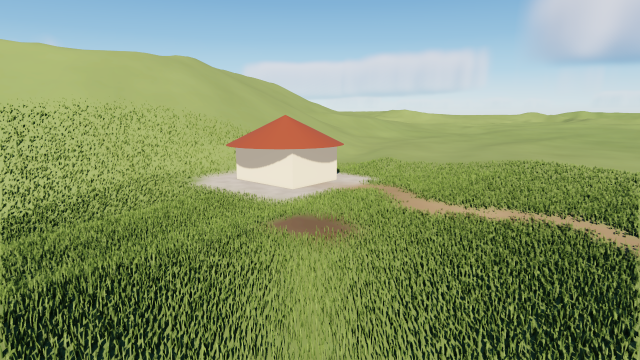

# Terrain edits (G19.1)

Non-destructive edits on top of the procedural terrain: an **ordered list of
stamps** stored with the scene and applied to every generated tile, after
generation, in order. A builder game flattens a foundation under a house,
paints a path and clears the grass on it; the edits stay correct when tiles
stream in and out, regenerate on the GPU, or the terrain moves.

*`assets/scenes/terrain_edits.json` (CI scene `terrain-edits`): a plinth
flattened at the foot of a hillside, a gravel apron, a garden soil patch and
a dirt path with its grass cleared and its ground smoothed. Grass regrows on
the levelled, unmasked ring around the apron.*

## Stamps

A stamp is a **shape**, an **outset** and a **falloff**, and an **operation**.

| Shape | Points | `radius` |
|---|---|---|
| `circle` | the centre | the circle's radius |
| `capsule` | a polyline (a curve sampled into points; one point is a disc) | half-width |
| `polygon` | a closed ring, either winding, convex or not | outset beyond the ring |

Coverage is 1 inside the shape grown by `radius`, falls to 0 over the next
`falloff` metres (a smoothstep of the distance), and is 0 beyond. Distances
are Quilez's 2D signed distance functions.

| Operation | Fields | Effect (blend `a` = coverage × `strength`) |
|---|---|---|
| `flatten` | `height`, `pivot`, `normal` | `h = lerp(h, target, a)`; the target is `height` at `pivot`, level, or the plane through it with the upward `normal` |
| `raise` / `lower` | `amount` (m) | `h ± amount × a` |
| `smooth` | `iterations` (1..16) | per pass, `h = lerp(h, 3×3 binomial blur, a)` |
| `paint` | `channel`, `value` | `channel = lerp(channel, value, a)` (8-bit) |

Paint channels, one RGBA8 texel per height texel:

| Channel | Meaning |
|---|---|
| `dirt` | path dirt (red channel) |
| `gravel` | gravel / stone path (green) |
| `soil` | garden soil (blue) |
| `grass` | grass-density mask (alpha; 1 = full density, the default; 0 = none) |

The terrain shader blends the painted materials over its procedural grass /
rock splat (under the snow). The grass pass multiplies the mask into its
slope fade (`grass_ground_keep` = slope keep × mask): a painted-out path thins
the way a steep slope does — blades shrink, then drop, with no hard edge —
and ground a `flatten` levels regains the density its slope had faded away.

Recipes (the cozy builder's, [`design/cozy-builder.md`](design/cozy-builder.md)):

- **Foundation**: `flatten` over the footprint polygon, `radius` 1 m,
  `falloff` 2–8 m (a wider falloff gives a gentler, grassed embankment), at
  the median ground height under it; then `paint gravel` and `paint grass 0`
  slightly wider than the footprint.
  Cutting a level pad deep into a slope leaves a cut bank steeper than the
  slope itself, whatever the falloff (the cut deepens as the falloff
  widens): past the grass layer's slope limit it shows the terrain's bare
  rock shading. Site foundations where the cut stays shallow, or dress the
  bank (a retaining wall, a `smooth` and a `paint soil` stamp).
- **Path**: a `capsule` along the stroke: `paint dirt`, `paint grass 0`, and a
  light `smooth` (strength 0.5–0.8, 1–2 iterations).

## Where edits live

- The `terrain_edits` component on the Terrain entity holds the list
  (`{stamps:[...], next_id}`) in **terrain-local** coordinates: metres from the
  Terrain entity's position, heights relative to its Y. Scene files and
  play-mode snapshots carry it; ids are stable and never reused.
- `scene::TerrainEdits` (`engine/scene/terrain_edits.hpp`, no graphics types)
  is the service game modules, Lua and the remote commands use. It takes and
  returns **world-space** stamps.
- `engine/terrain/edits.hpp` holds the stamp model, the list, and the CPU
  reference; `edit_sync.hpp` keeps loaded tiles in step with a list.

## Application and refresh

Each tile keeps its generated heights (`Heightmap::base_heights`) once an
edit touches it. Every frame the runtime (`src/app/world_terrain_edits.cpp`)
compares the list's revision with the one it applied; on a change it diffs
the stamps (`changed_regions`: the old and new bounds of every stamp added,
removed, changed or reordered) and, per overlapping tile, recomputes **only
those regions** (`apply_edits`). A dirty region grows through the reach of
every later smooth stamp, and the recompute window grows by the blur reach
of the smooth stamps around it, so a region recompute equals a whole-tile
recompute bit for bit (tested). Then:

| Consumer | Refresh |
|---|---|
| Terrain pass | the tile's height and paint images are rebuilt from the CPU tile (a fresh image; frames still reading the old one are unaffected) |
| Grass | reads the paint image's alpha as its mask — nothing else to do |
| Jolt | `HeightFieldShape::SetHeights` on the touched blocks, in place, waking bodies resting there; height fields reserve ±128 m of headroom at creation, beyond which the body is rebuilt |
| Scatters | the ground revision hashes each tile's 16×16 **edit cells** under a scatter, so only scatters over changed cells regenerate |
| Navmesh | invalidated (and auto-rebaked for agents) only when a changed region touches its bounds |

Tiles that load later (streaming, regeneration) get the whole list applied
before upload. On the GPU path (R10.2) the synthesis job applies the stamps
that reach its tile in compute (`TerrainEditPass`, `terrain_edit.slang`)
before the tile image is written and read back, so a tile arrives edited
with its paint image; if the list changed in the meantime, the CPU
recomputes it on arrival.

**Determinism.** A texel's position comes from its integer world texel index,
so tiles sharing an edge evaluate identical inputs; smoothing is pinned to 0
on tile-border texels so shared edges stay identical. The GPU kernels mirror
the CPU reference op for op with the same precomputed reciprocals and plane
slopes; GPU `sqrt` and fused multiply-adds may differ by an ULP, so the tests
allow 2 mm and one 8-bit paint step (lavapipe matches bit for bit).

## API

- Remote: `terrain.edit.add / update / remove / list / clear`
  ([`remote-control.md`](remote-control.md#terrain-edits-roadmap-g191)).
- MCP: `terrain_edit_add`, `terrain_edit_update`, `terrain_edit_remove`,
  `terrain_edit_list`, `terrain_edit_clear`.
- Lua: `terrain.edit.add(stamp, before?)` → id, `terrain.edit.update(id,
  fields)`, `terrain.edit.remove(id)` → bool, `terrain.edit.list()`,
  `terrain.edit.clear()` → count ([`scripting.md`](scripting.md#terrain)).
- C++: `scene::TerrainEdits(registry).add(stamp)` and friends.

Limits: 4096 stamps, 256 points per stamp, `radius + falloff` ≤ 4096 m,
`amount` ≤ 1000 m.

## Follow-ups

- Tiled navmesh rebuilds (Recast tile cache) instead of invalidating the
  whole bake when an edit touches it.
- A `snow_clear` channel for swept paths (R25.3).
- Editor brushes over the same service (E-track).
