# CI screenshots

Rendered by the `linux` job of `.github/workflows/ci.yml` (lavapipe under
Xvfb, `scripts/ci-screenshots.sh`) for pushes and same-repository pull
requests, and committed here by `scripts/ci-publish-screenshots.sh`.
Newest first. Images live under `runs/<pr-N or branch>/<commit>/`.

## master @ `3112d545` — 2026-11-28 11:10 UTC

[CI run](https://github.com/tomerab1/quat-3d/actions/runs/46133234571) · ref `master` · commit [`3112d545`](https://github.com/tomerab1/quat-3d/commit/3112d545ac9a7f6b2e5c9fc9aa405a3609eb32e7)

| Scene | Result | Image |
|---|---|---|
| `showcase-editor` — Showcase scene with the editor UI (1600x900) | ok (10 s) |  |
| `editor-inspector` — Editor with an entity selected (Inspector) | ok (8 s) |  |
| `showcase` — Showcase scene, no UI | ok (11 s) |  |
| `terrain` — Showcase + GPU-generated terrain tile | ok (46 s) |  |
| `physics` — Physics demo (Jolt) after 90 frames | ok (38 s) |  |

## pr-108 @ `c4eabfe8` — 2026-11-28 10:51 UTC

[CI run](https://github.com/tomerab1/quat-3d/actions/runs/46133575015) · ref `feat/a12-followups` · commit [`c4eabfe8`](https://github.com/tomerab1/quat-3d/commit/c4eabfe8aeac67421bb32bf9aca17a5f623f729b)

| Scene | Result | Image |
|---|---|---|
| `showcase-editor` — Showcase scene with the editor UI (1600x900) | ok (7 s) | <a href="runs/pr-108/c4eabfe8/showcase-editor.png">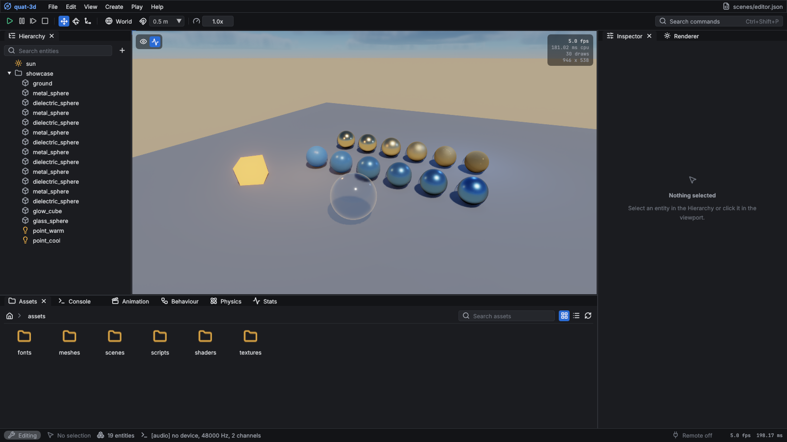</a> |
| `editor-inspector` — Editor with an entity selected (Inspector) | ok (6 s) |  |
| `showcase` — Showcase scene, no UI | ok (9 s) |  |
| `terrain` — Showcase + GPU-generated terrain tile | ok (39 s) |  |
| `physics` — Physics demo (Jolt) after 90 frames | ok (27 s) |  |

## pr-96 @ `f8adfd9c` — 2026-11-28 10:37 UTC

[CI run](https://github.com/tomerab1/quat-3d/actions/runs/46133475814) · ref `feat/release-notes` · commit [`f8adfd9c`](https://github.com/tomerab1/quat-3d/commit/f8adfd9c2128e9d7c35c9acebda59510abb438e0)

| Scene | Result | Image |
|---|---|---|
| `showcase-editor` — Showcase scene with the editor UI (1600x900) | ok (9 s) |  |
| `editor-inspector` — Editor with an entity selected (Inspector) | ok (8 s) |  |
| `showcase` — Showcase scene, no UI | ok (11 s) |  |
| `terrain` — Showcase + GPU-generated terrain tile | ok (47 s) |  |
| `physics` — Physics demo (Jolt) after 90 frames | ok (38 s) |  |

## pr-106 @ `d0f1bb97` — 2026-11-28 10:35 UTC

[CI run](https://github.com/tomerab1/quat-3d/actions/runs/46132405794) · ref `feat/macos-pipeline-diag` · commit [`d0f1bb97`](https://github.com/tomerab1/quat-3d/commit/d0f1bb9727c536497eec4635b6ad86912d817e1d)

| Scene | Result | Image |
|---|---|---|
| `showcase-editor` — Showcase scene with the editor UI (1600x900) | ok (9 s) |  |
| `editor-inspector` — Editor with an entity selected (Inspector) | ok (8 s) |  |
| `showcase` — Showcase scene, no UI | ok (11 s) | <a href="runs/pr-106/d0f1bb97/showcase.png">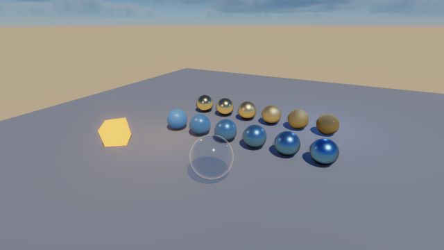</a> |
| `terrain` — Showcase + GPU-generated terrain tile | ok (46 s) |  |
| `physics` — Physics demo (Jolt) after 90 frames | ok (38 s) |  |

## pr-80 @ `ccb327a7` — 2026-11-28 10:29 UTC

[CI run](https://github.com/tomerab1/quat-3d/actions/runs/46131792695) · ref `feat/r-lighting-realism` · commit [`ccb327a7`](https://github.com/tomerab1/quat-3d/commit/ccb327a71bfeda2005300e3825c5f64b8d3d463d)

| Scene | Result | Image |
|---|---|---|
| `showcase-editor` — Showcase scene with the editor UI (1600x900) | ok (11 s) | <a href="runs/pr-80/ccb327a7/showcase-editor.png">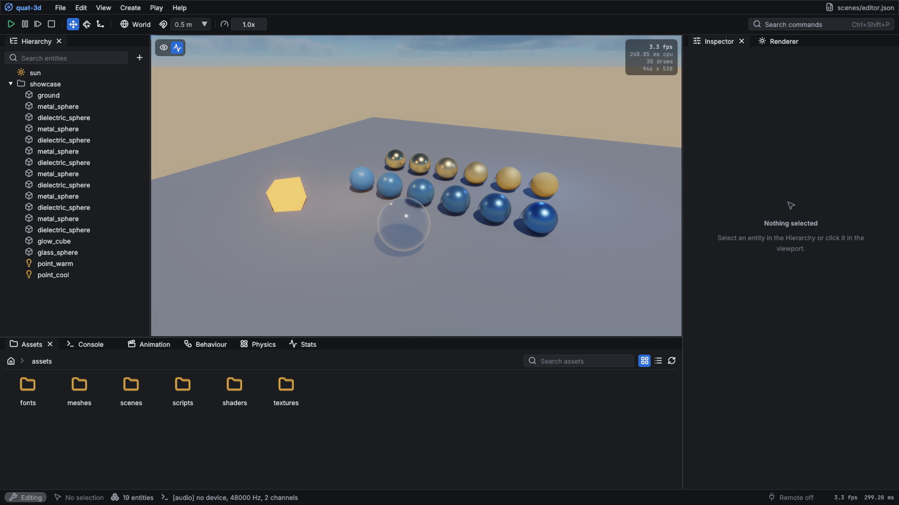</a> |
| `editor-inspector` — Editor with an entity selected (Inspector) | ok (9 s) |  |
| `showcase` — Showcase scene, no UI | ok (13 s) | <a href="runs/pr-80/ccb327a7/showcase.png">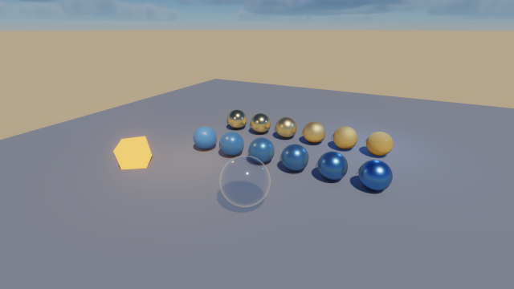</a> |
| `terrain` — Showcase + GPU-generated terrain tile | ok (55 s) | <a href="runs/pr-80/ccb327a7/terrain.png">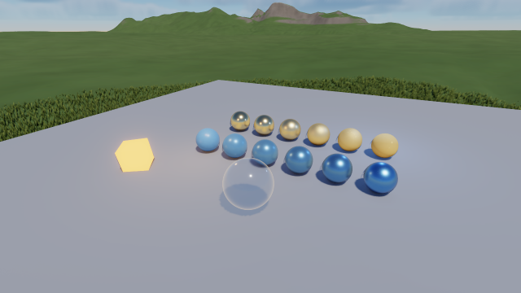</a> |
| `physics` — Physics demo (Jolt) after 90 frames | ok (41 s) |  |
| `showcase-hdri` — Showcase lit by a CC0 Poly Haven HDRI (R21: HDRI IBL, its sun as the shadowed light, SSR) | ok (18 s) | <a href="runs/pr-80/ccb327a7/showcase-hdri.png">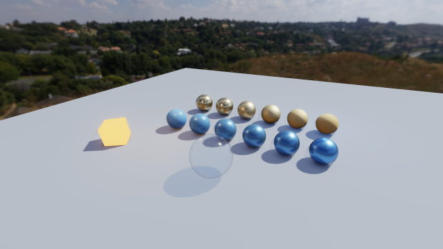</a> |

## pr-49 @ `6d7574c5` — 2026-11-28 10:07 UTC

[CI run](https://github.com/tomerab1/quat-3d/actions/runs/46131844268) · ref `feat/mountain-scene` · commit [`6d7574c5`](https://github.com/tomerab1/quat-3d/commit/6d7574c578fd418a3f7186bb985c72efc9e112da)

| Scene | Result | Image |
|---|---|---|
| `showcase-editor` — Showcase scene with the editor UI (1600x900) | ok (10 s) |  |
| `editor-inspector` — Editor with an entity selected (Inspector) | ok (8 s) | <a href="runs/pr-49/6d7574c5/editor-inspector.png">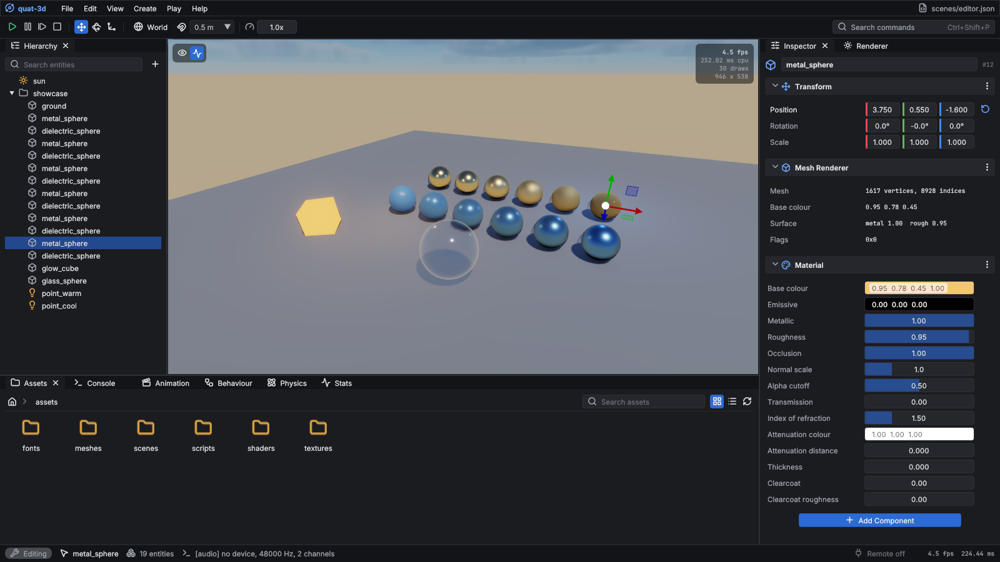</a> |
| `showcase` — Showcase scene, no UI | ok (12 s) |  |
| `terrain` — Showcase + GPU-generated terrain tile | ok (47 s) |  |
| `physics` — Physics demo (Jolt) after 90 frames | ok (39 s) |  |
| `mountain-forest` — Mountain + forest showcase: terrain, scattered trees and rocks, GPU grass | ok (25 s) | <a href="runs/pr-49/6d7574c5/mountain-forest.png">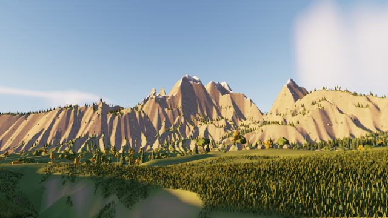</a> |

## pr-83 @ `db7df590` — 2026-11-28 09:55 UTC

[CI run](https://github.com/tomerab1/quat-3d/actions/runs/46131425120) · ref `feat/a12-skills` · commit [`db7df590`](https://github.com/tomerab1/quat-3d/commit/db7df5904b046a4e2316b2e2c5409dcc8e722b62)

| Scene | Result | Image |
|---|---|---|
| `showcase-editor` — Showcase scene with the editor UI (1600x900) | ok (9 s) |  |
| `editor-inspector` — Editor with an entity selected (Inspector) | ok (8 s) |  |
| `showcase` — Showcase scene, no UI | ok (11 s) |  |
| `terrain` — Showcase + GPU-generated terrain tile | ok (47 s) |  |
| `physics` — Physics demo (Jolt) after 90 frames | ok (39 s) |  |

## pr-49 @ `d9aab888` — 2026-11-28 09:39 UTC

[CI run](https://github.com/tomerab1/quat-3d/actions/runs/46130256466) · ref `feat/mountain-scene` · commit [`d9aab888`](https://github.com/tomerab1/quat-3d/commit/d9aab88832ad377ece1c1f368826a16e0b0e6c11)

| Scene | Result | Image |
|---|---|---|
| `showcase-editor` — Showcase scene with the editor UI (1600x900) | ok (10 s) |  |
| `editor-inspector` — Editor with an entity selected (Inspector) | ok (7 s) |  |
| `showcase` — Showcase scene, no UI | ok (11 s) |  |
| `terrain` — Showcase + GPU-generated terrain tile | ok (46 s) |  |
| `physics` — Physics demo (Jolt) after 90 frames | ok (38 s) |  |
| `mountain-forest` — Mountain + forest showcase: terrain, scattered trees and rocks, GPU grass | ok (25 s) | <a href="runs/pr-49/d9aab888/mountain-forest.png">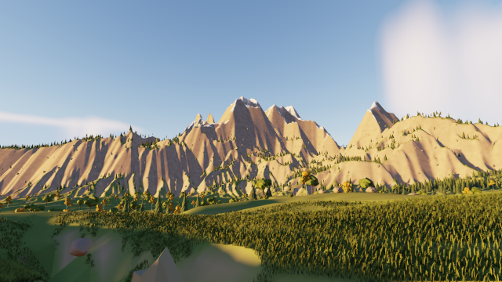</a> |

## pr-82 @ `77f5ca4e` — 2026-11-28 09:29 UTC

[CI run](https://github.com/tomerab1/quat-3d/actions/runs/46129065448) · ref `feat/r4-profiling` · commit [`77f5ca4e`](https://github.com/tomerab1/quat-3d/commit/77f5ca4ec266dd46aff35c2dc50dffc8d1a9ccc7)

| Scene | Result | Image |
|---|---|---|
| `showcase-editor` — Showcase scene with the editor UI (1600x900) | ok (12 s) |  |
| `editor-inspector` — Editor with an entity selected (Inspector) | ok (11 s) | <a href="runs/pr-82/77f5ca4e/editor-inspector.png">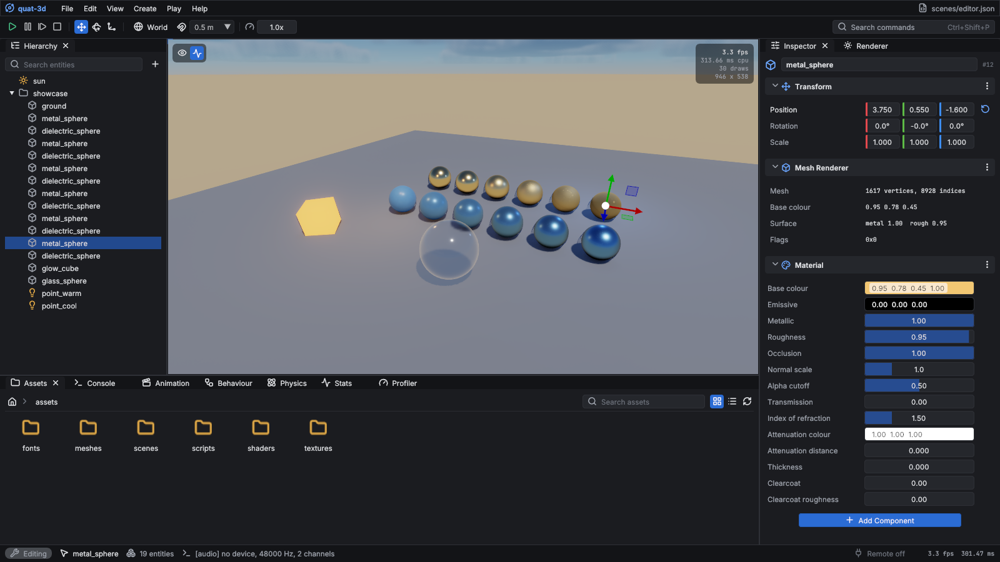</a> |
| `showcase` — Showcase scene, no UI | ok (16 s) |  |
| `terrain` — Showcase + GPU-generated terrain tile | ok (63 s) |  |
| `physics` — Physics demo (Jolt) after 90 frames | ok (51 s) | <a href="runs/pr-82/77f5ca4e/physics.png">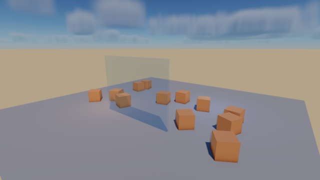</a> |

## pr-64 @ `c8315421` — 2026-11-28 09:29 UTC

[CI run](https://github.com/tomerab1/quat-3d/actions/runs/46128563950) · ref `feat/r13-weather` · commit [`c8315421`](https://github.com/tomerab1/quat-3d/commit/c83154212ef89ab9054ba41d8a5f894132625b12)

| Scene | Result | Image |
|---|---|---|
| `showcase-editor` — Showcase scene with the editor UI (1600x900) | ok (15 s) |  |
| `editor-inspector` — Editor with an entity selected (Inspector) | ok (10 s) |  |
| `showcase` — Showcase scene, no UI | ok (15 s) |  |
| `terrain` — Showcase + GPU-generated terrain tile | ok (59 s) |  |
| `physics` — Physics demo (Jolt) after 90 frames | ok (44 s) |  |

## pr-93 @ `16e429c2` — 2026-11-28 09:28 UTC

[CI run](https://github.com/tomerab1/quat-3d/actions/runs/46129433914) · ref `claude/nifty-hopper-nb68qe` · commit [`16e429c2`](https://github.com/tomerab1/quat-3d/commit/16e429c21557b100f2f4d3dbd2a7940bb372b2fd)

| Scene | Result | Image |
|---|---|---|
| `showcase-editor` — Showcase scene with the editor UI (1600x900) | ok (8 s) |  |
| `editor-inspector` — Editor with an entity selected (Inspector) | ok (7 s) |  |
| `showcase` — Showcase scene, no UI | ok (11 s) |  |
| `terrain` — Showcase + GPU-generated terrain tile | ok (47 s) | <a href="runs/pr-93/16e429c2/terrain.png">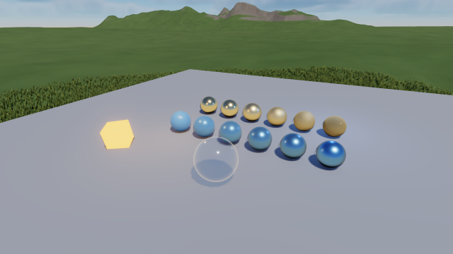</a> |
| `physics` — Physics demo (Jolt) after 90 frames | ok (38 s) |  |

## pr-54 @ `0bdf0ec7` — 2026-11-28 09:22 UTC

[CI run](https://github.com/tomerab1/quat-3d/actions/runs/46128851631) · ref `feat/a10-physics-control` · commit [`0bdf0ec7`](https://github.com/tomerab1/quat-3d/commit/0bdf0ec7a3856da19938f75fc9a3cba1bdb4c5da)

| Scene | Result | Image |
|---|---|---|
| `showcase-editor` — Showcase scene with the editor UI (1600x900) | ok (9 s) |  |
| `editor-inspector` — Editor with an entity selected (Inspector) | ok (8 s) |  |
| `showcase` — Showcase scene, no UI | ok (11 s) |  |
| `terrain` — Showcase + GPU-generated terrain tile | ok (47 s) |  |
| `physics` — Physics demo (Jolt) after 90 frames | ok (39 s) |  |

## pr-83 @ `a1088fcf` — 2026-11-28 09:09 UTC

[CI run](https://github.com/tomerab1/quat-3d/actions/runs/46127807866) · ref `feat/a12-skills` · commit [`a1088fcf`](https://github.com/tomerab1/quat-3d/commit/a1088fcfc33545cce41a6e38b0dfde16d5989101)

| Scene | Result | Image |
|---|---|---|
| `showcase-editor` — Showcase scene with the editor UI (1600x900) | ok (11 s) |  |
| `editor-inspector` — Editor with an entity selected (Inspector) | ok (9 s) |  |
| `showcase` — Showcase scene, no UI | ok (13 s) |  |
| `terrain` — Showcase + GPU-generated terrain tile | ok (55 s) |  |
| `physics` — Physics demo (Jolt) after 90 frames | ok (43 s) |  |

## pr-79 @ `087d479b` — 2026-11-28 09:06 UTC

[CI run](https://github.com/tomerab1/quat-3d/actions/runs/46127689590) · ref `feat/r-cinematic-post` · commit [`087d479b`](https://github.com/tomerab1/quat-3d/commit/087d479b0d7ccd4a47529f096abca83ae871074c)

| Scene | Result | Image |
|---|---|---|
| `showcase-editor` — Showcase scene with the editor UI (1600x900) | ok (10 s) | <a href="runs/pr-79/087d479b/showcase-editor.png">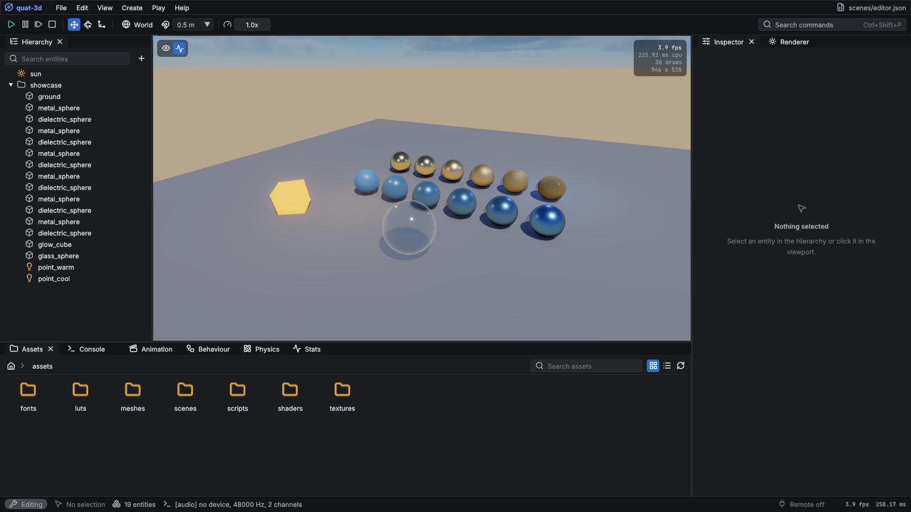</a> |
| `editor-inspector` — Editor with an entity selected (Inspector) | ok (7 s) |  |
| `showcase` — Showcase scene, no UI | ok (12 s) |  |
| `terrain` — Showcase + GPU-generated terrain tile | ok (48 s) |  |
| `physics` — Physics demo (Jolt) after 90 frames | ok (39 s) |  |

## pr-93 @ `31f5fc18` — 2026-11-28 08:57 UTC

[CI run](https://github.com/tomerab1/quat-3d/actions/runs/46126458831) · ref `claude/nifty-hopper-nb68qe` · commit [`31f5fc18`](https://github.com/tomerab1/quat-3d/commit/31f5fc18e77e05d87f35a97b9b7437487d988ea7)

| Scene | Result | Image |
|---|---|---|
| `showcase-editor` — Showcase scene with the editor UI (1600x900) | ok (10 s) |  |
| `editor-inspector` — Editor with an entity selected (Inspector) | ok (8 s) |  |
| `showcase` — Showcase scene, no UI | ok (11 s) |  |
| `terrain` — Showcase + GPU-generated terrain tile | ok (46 s) |  |
| `physics` — Physics demo (Jolt) after 90 frames | ok (38 s) |  |

## pr-87 @ `f6a016a5` — 2026-11-28 08:55 UTC

[CI run](https://github.com/tomerab1/quat-3d/actions/runs/46127237646) · ref `feat/r22-time-of-day` · commit [`f6a016a5`](https://github.com/tomerab1/quat-3d/commit/f6a016a59819e30dcb141cd175b27077e8bf4b8a)

| Scene | Result | Image |
|---|---|---|
| `showcase-editor` — Showcase scene with the editor UI (1600x900) | ok (7 s) |  |
| `editor-inspector` — Editor with an entity selected (Inspector) | ok (6 s) |  |
| `showcase` — Showcase scene, no UI | ok (8 s) |  |
| `terrain` — Showcase + GPU-generated terrain tile | ok (31 s) |  |
| `physics` — Physics demo (Jolt) after 90 frames | ok (24 s) |  |
| `sunrise` — World clock: Paris, June solstice, 06:10 (sun 2.5° up, north-east) | ok (8 s) | <a href="runs/pr-87/f6a016a5/sunrise.png">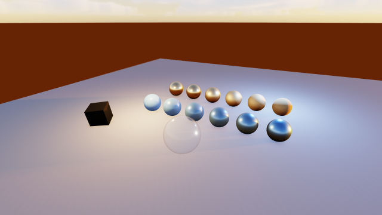</a> |
| `noon` — World clock: Paris, June solstice, solar noon (sun 64.6° up, south) | ok (8 s) | <a href="runs/pr-87/f6a016a5/noon.png">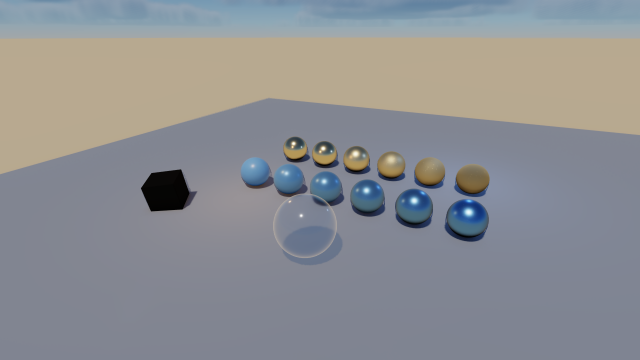</a> |
| `sunset` — World clock: Paris, June solstice, 21:35 (sun 2.5° up, north-west) | ok (8 s) |  |
| `editor-time-of-day` — Editor: the world clock in the Inspector at sunset | ok (5 s) | <a href="runs/pr-87/f6a016a5/editor-time-of-day.png">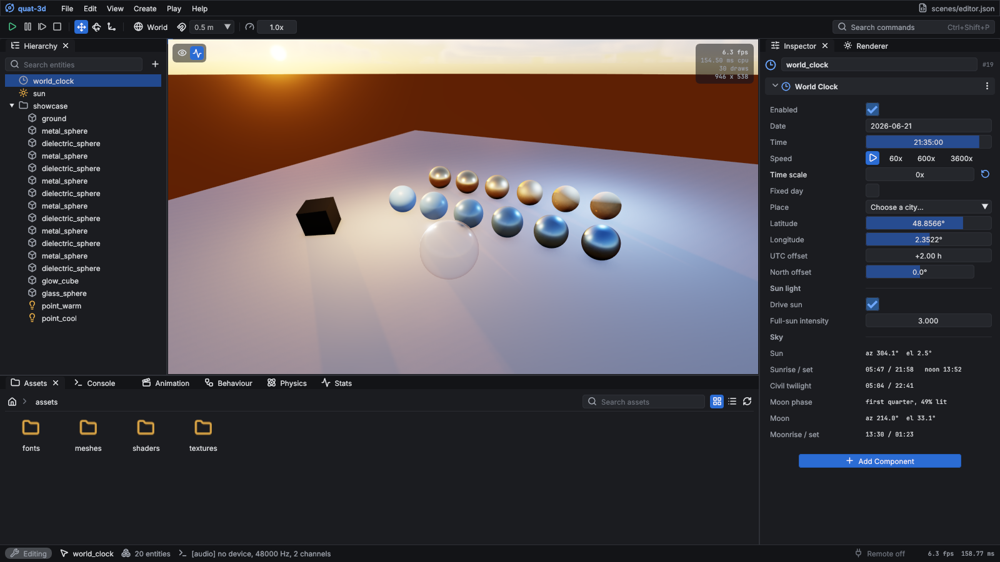</a> |

## pr-102 @ `e5e10ea6` — 2026-11-28 08:50 UTC

[CI run](https://github.com/tomerab1/quat-3d/actions/runs/46126146224) · ref `feat/ui-srgb-composite` · commit [`e5e10ea6`](https://github.com/tomerab1/quat-3d/commit/e5e10ea681bdc39b86553ea1537bd221c97d33d0)

| Scene | Result | Image |
|---|---|---|
| `showcase-editor` — Showcase scene with the editor UI (1600x900) | ok (11 s) | <a href="runs/pr-102/e5e10ea6/showcase-editor.png">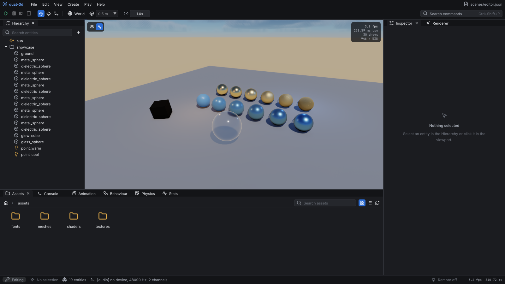</a> |
| `editor-inspector` — Editor with an entity selected (Inspector) | ok (9 s) | <a href="runs/pr-102/e5e10ea6/editor-inspector.png">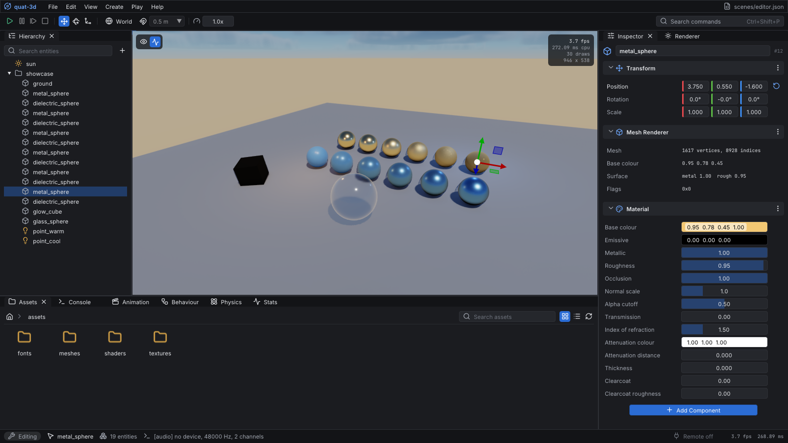</a> |
| `showcase` — Showcase scene, no UI | ok (13 s) |  |
| `terrain` — Showcase + GPU-generated terrain tile | ok (55 s) | <a href="runs/pr-102/e5e10ea6/terrain.png">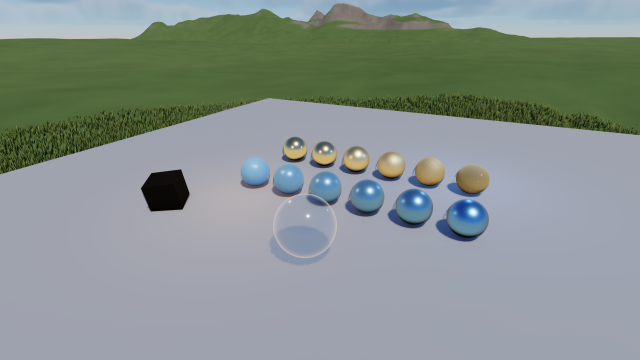</a> |
| `physics` — Physics demo (Jolt) after 90 frames | ok (40 s) |  |

## pr-94 @ `12a42ac0` — 2026-11-28 08:35 UTC

[CI run](https://github.com/tomerab1/quat-3d/actions/runs/46125243872) · ref `feat/nav-separation-grid` · commit [`12a42ac0`](https://github.com/tomerab1/quat-3d/commit/12a42ac02cef0a2a1f72b309c651dbd49c410b2a)

| Scene | Result | Image |
|---|---|---|
| `showcase-editor` — Showcase scene with the editor UI (1600x900) | ok (11 s) |  |
| `editor-inspector` — Editor with an entity selected (Inspector) | ok (9 s) |  |
| `showcase` — Showcase scene, no UI | ok (13 s) |  |
| `terrain` — Showcase + GPU-generated terrain tile | ok (55 s) |  |
| `physics` — Physics demo (Jolt) after 90 frames | ok (46 s) |  |

## master @ `0c8d1eac` — 2026-11-28 08:10 UTC

[CI run](https://github.com/tomerab1/quat-3d/actions/runs/46123363034) · ref `master` · commit [`0c8d1eac`](https://github.com/tomerab1/quat-3d/commit/0c8d1eacb24754aa0296c800941d5bffff8a43e4)

| Scene | Result | Image |
|---|---|---|
| `showcase-editor` — Showcase scene with the editor UI (1600x900) | ok (11 s) |  |
| `editor-inspector` — Editor with an entity selected (Inspector) | ok (9 s) |  |
| `showcase` — Showcase scene, no UI | ok (14 s) |  |
| `terrain` — Showcase + GPU-generated terrain tile | ok (53 s) |  |
| `physics` — Physics demo (Jolt) after 90 frames | ok (44 s) |  |

## pr-89 @ `51234175` — 2026-11-28 08:09 UTC

[CI run](https://github.com/tomerab1/quat-3d/actions/runs/46123575846) · ref `feat/contact-shadow-edges` · commit [`51234175`](https://github.com/tomerab1/quat-3d/commit/512341753f025e12552ed499d1791bc84c2912c7)

| Scene | Result | Image |
|---|---|---|
| `showcase-editor` — Showcase scene with the editor UI (1600x900) | ok (8 s) | <a href="runs/pr-89/51234175/showcase-editor.png">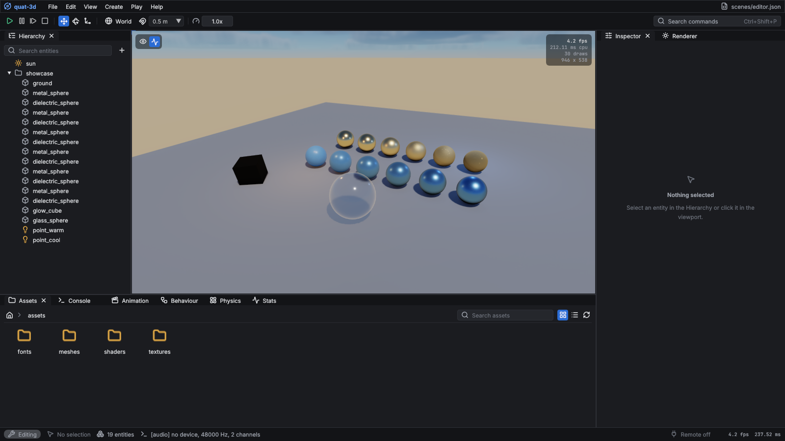</a> |
| `editor-inspector` — Editor with an entity selected (Inspector) | ok (8 s) |  |
| `showcase` — Showcase scene, no UI | ok (11 s) |  |
| `terrain` — Showcase + GPU-generated terrain tile | ok (44 s) |  |
| `physics` — Physics demo (Jolt) after 90 frames | ok (36 s) |  |

## pr-94 @ `6fb452a2` — 2026-11-28 08:04 UTC

[CI run](https://github.com/tomerab1/quat-3d/actions/runs/46123241165) · ref `feat/nav-separation-grid` · commit [`6fb452a2`](https://github.com/tomerab1/quat-3d/commit/6fb452a2e8232fb3a630812e4b95424cfbb9f502)

| Scene | Result | Image |
|---|---|---|
| `showcase-editor` — Showcase scene with the editor UI (1600x900) | ok (9 s) |  |
| `editor-inspector` — Editor with an entity selected (Inspector) | ok (7 s) | <a href="runs/pr-94/6fb452a2/editor-inspector.png">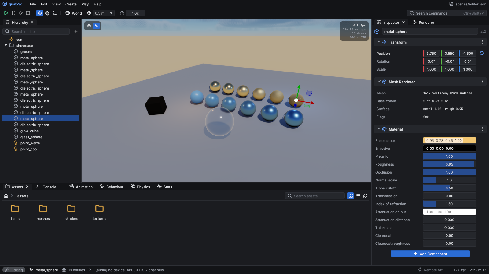</a> |
| `showcase` — Showcase scene, no UI | ok (10 s) |  |
| `terrain` — Showcase + GPU-generated terrain tile | ok (40 s) |  |
| `physics` — Physics demo (Jolt) after 90 frames | ok (35 s) |  |

## pr-93 @ `4beab47c` — 2026-11-28 07:56 UTC

[CI run](https://github.com/tomerab1/quat-3d/actions/runs/46122494412) · ref `claude/nifty-hopper-nb68qe` · commit [`4beab47c`](https://github.com/tomerab1/quat-3d/commit/4beab47cbac374b466d70508a61fc29d11247874)

| Scene | Result | Image |
|---|---|---|
| `showcase-editor` — Showcase scene with the editor UI (1600x900) | ok (8 s) |  |
| `editor-inspector` — Editor with an entity selected (Inspector) | ok (6 s) |  |
| `showcase` — Showcase scene, no UI | ok (9 s) |  |
| `terrain` — Showcase + GPU-generated terrain tile | ok (36 s) |  |
| `physics` — Physics demo (Jolt) after 90 frames | ok (27 s) |  |

## pr-90 @ `2751d1fe` — 2026-11-28 07:50 UTC

[CI run](https://github.com/tomerab1/quat-3d/actions/runs/46121984804) · ref `feat/terrain-fixes` · commit [`2751d1fe`](https://github.com/tomerab1/quat-3d/commit/2751d1fe69a2f46c7c013038c61c31c3b19f1eac)

| Scene | Result | Image |
|---|---|---|
| `showcase-editor` — Showcase scene with the editor UI (1600x900) | ok (9 s) |  |
| `editor-inspector` — Editor with an entity selected (Inspector) | ok (7 s) |  |
| `showcase` — Showcase scene, no UI | ok (10 s) | <a href="runs/pr-90/2751d1fe/showcase.png">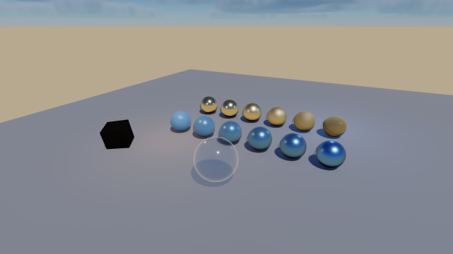</a> |
| `terrain` — Showcase + GPU-generated terrain tile | ok (41 s) |  |
| `physics` — Physics demo (Jolt) after 90 frames | ok (32 s) |  |

## pr-87 @ `debb34b5` — 2026-11-28 07:48 UTC

[CI run](https://github.com/tomerab1/quat-3d/actions/runs/46122058882) · ref `feat/r22-time-of-day` · commit [`debb34b5`](https://github.com/tomerab1/quat-3d/commit/debb34b550ea7c382721ebd9998d66982a7c0793)

| Scene | Result | Image |
|---|---|---|
| `showcase-editor` — Showcase scene with the editor UI (1600x900) | ok (7 s) |  |
| `editor-inspector` — Editor with an entity selected (Inspector) | ok (5 s) |  |
| `showcase` — Showcase scene, no UI | ok (8 s) |  |
| `terrain` — Showcase + GPU-generated terrain tile | ok (35 s) |  |
| `physics` — Physics demo (Jolt) after 90 frames | ok (27 s) |  |
| `sunrise` — World clock: Paris, June solstice, 06:10 (sun 2.5° up, north-east) | ok (9 s) |  |
| `noon` — World clock: Paris, June solstice, solar noon (sun 64.6° up, south) | ok (9 s) |  |
| `sunset` — World clock: Paris, June solstice, 21:35 (sun 2.5° up, north-west) | ok (8 s) | <a href="runs/pr-87/debb34b5/sunset.png">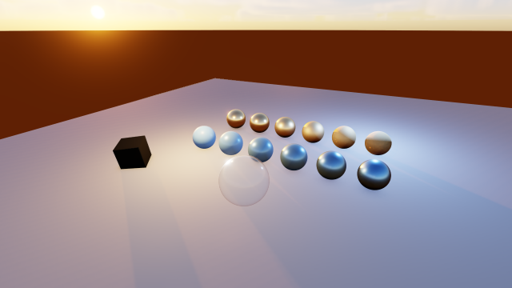</a> |
| `editor-time-of-day` — Editor: the world clock in the Inspector at sunset | ok (6 s) | <a href="runs/pr-87/debb34b5/editor-time-of-day.png">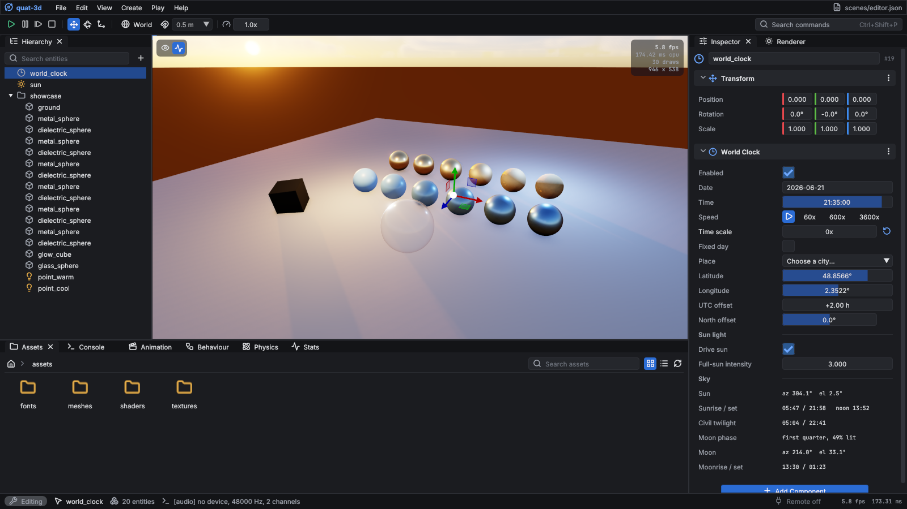</a> |

## pr-89 @ `690ff2c6` — 2026-11-27 23:55 UTC

[CI run](https://github.com/tomerab1/quat-3d/actions/runs/46083927552) · ref `feat/contact-shadow-edges` · commit [`690ff2c6`](https://github.com/tomerab1/quat-3d/commit/690ff2c635d5a3e53c0cb55f161cba416b44e5f7)

| Scene | Result | Image |
|---|---|---|
| `showcase-editor` — Showcase scene with the editor UI (1600x900) | ok (10 s) |  |
| `editor-inspector` — Editor with an entity selected (Inspector) | ok (8 s) | <a href="runs/pr-89/690ff2c6/editor-inspector.png">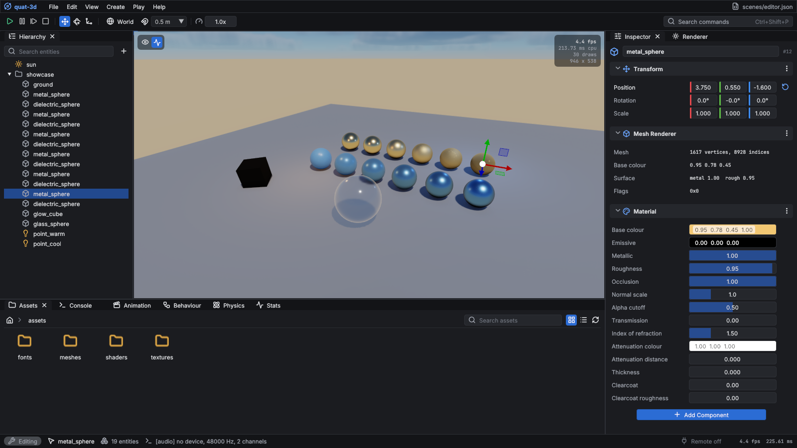</a> |
| `showcase` — Showcase scene, no UI | ok (11 s) |  |
| `terrain` — Showcase + GPU-generated terrain tile | ok (44 s) |  |
| `physics` — Physics demo (Jolt) after 90 frames | ok (32 s) |  |

## pr-91 @ `1f72135c` — 2026-11-27 23:51 UTC

[CI run](https://github.com/tomerab1/quat-3d/actions/runs/46082806543) · ref `feat/showcase-cinematic` · commit [`1f72135c`](https://github.com/tomerab1/quat-3d/commit/1f72135c91f88ad09830869008bbbf1ab0aae897)

| Scene | Result | Image |
|---|---|---|
| `showcase-editor` — Showcase scene with the editor UI (1600x900) | ok (9 s) | <a href="runs/pr-91/1f72135c/showcase-editor.png">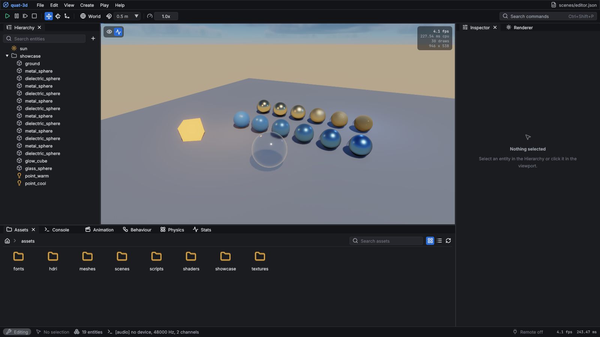</a> |
| `editor-inspector` — Editor with an entity selected (Inspector) | ok (7 s) |  |
| `showcase` — Showcase scene, no UI | ok (11 s) |  |
| `terrain` — Showcase + GPU-generated terrain tile | ok (46 s) |  |
| `physics` — Physics demo (Jolt) after 90 frames | ok (38 s) | <a href="runs/pr-91/1f72135c/physics.png">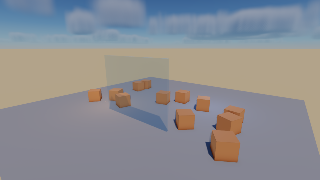</a> |
| `cinematic` — Cinematic forest clearing at golden hour (CC0 Poly Haven assets), hero camera | ok (232 s) | <a href="runs/pr-91/1f72135c/cinematic.png">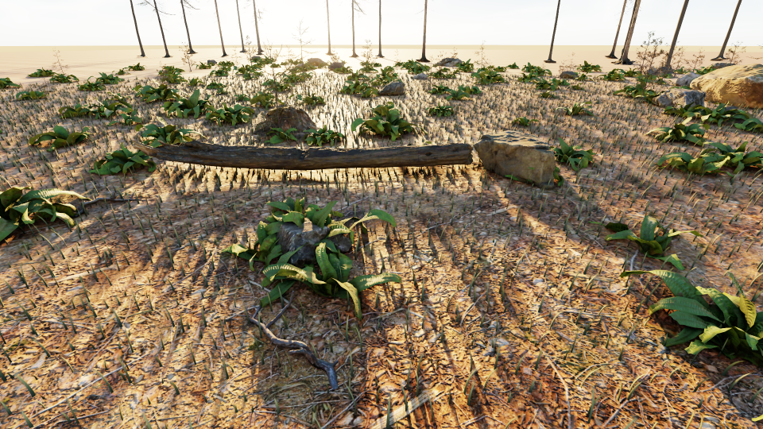</a> |

## master @ `ee99263a` — 2026-11-27 23:41 UTC

[CI run](https://github.com/tomerab1/quat-3d/actions/runs/46082146248) · ref `master` · commit [`ee99263a`](https://github.com/tomerab1/quat-3d/commit/ee99263a93ea6f10097c2e390be50c61b1e2e178)

| Scene | Result | Image |
|---|---|---|
| `showcase-editor` — Showcase scene with the editor UI (1600x900) | ok (12 s) |  |
| `editor-inspector` — Editor with an entity selected (Inspector) | ok (9 s) |  |
| `showcase` — Showcase scene, no UI | ok (13 s) |  |
| `terrain` — Showcase + GPU-generated terrain tile | ok (54 s) |  |
| `physics` — Physics demo (Jolt) after 90 frames | ok (39 s) |  |

## pr-90 @ `20207620` — 2026-11-27 23:27 UTC

[CI run](https://github.com/tomerab1/quat-3d/actions/runs/46081515877) · ref `feat/terrain-fixes` · commit [`20207620`](https://github.com/tomerab1/quat-3d/commit/20207620cb6b4c0d924e9d2f52d75110cffc1d4e)

| Scene | Result | Image |
|---|---|---|
| `showcase-editor` — Showcase scene with the editor UI (1600x900) | ok (9 s) |  |
| `editor-inspector` — Editor with an entity selected (Inspector) | ok (7 s) |  |
| `showcase` — Showcase scene, no UI | ok (10 s) |  |
| `terrain` — Showcase + GPU-generated terrain tile | ok (41 s) |  |
| `physics` — Physics demo (Jolt) after 90 frames | ok (36 s) |  |

## pr-89 @ `d249152a` — 2026-11-27 23:25 UTC

[CI run](https://github.com/tomerab1/quat-3d/actions/runs/46081299405) · ref `feat/contact-shadow-edges` · commit [`d249152a`](https://github.com/tomerab1/quat-3d/commit/d249152acf43b4c985ea9c56d8468c1c37bf82a7)

| Scene | Result | Image |
|---|---|---|
| `showcase-editor` — Showcase scene with the editor UI (1600x900) | ok (9 s) |  |
| `editor-inspector` — Editor with an entity selected (Inspector) | ok (7 s) |  |
| `showcase` — Showcase scene, no UI | ok (11 s) |  |
| `terrain` — Showcase + GPU-generated terrain tile | ok (43 s) |  |
| `physics` — Physics demo (Jolt) after 90 frames | ok (35 s) |  |

## pr-88 @ `3d83808f` — 2026-11-27 23:17 UTC

[CI run](https://github.com/tomerab1/quat-3d/actions/runs/46080477545) · ref `feat/e8-followups` · commit [`3d83808f`](https://github.com/tomerab1/quat-3d/commit/3d83808f319d531709d2000c794e766b38f799ef)

| Scene | Result | Image |
|---|---|---|
| `showcase-editor` — Showcase scene with the editor UI (1600x900) | ok (9 s) |  |
| `editor-inspector` — Editor with an entity selected (Inspector) | ok (7 s) |  |
| `showcase` — Showcase scene, no UI | ok (10 s) |  |
| `terrain` — Showcase + GPU-generated terrain tile | ok (41 s) |  |
| `physics` — Physics demo (Jolt) after 90 frames | ok (35 s) |  |

## master @ `4749db5d` — 2026-11-27 23:06 UTC

[CI run](https://github.com/tomerab1/quat-3d/actions/runs/46079210027) · ref `master` · commit [`4749db5d`](https://github.com/tomerab1/quat-3d/commit/4749db5d9a7e26bee1cae78490013c0d07d72abc)

| Scene | Result | Image |
|---|---|---|
| `showcase-editor` — Showcase scene with the editor UI (1600x900) | ok (8 s) |  |
| `editor-inspector` — Editor with an entity selected (Inspector) | ok (7 s) |  |
| `showcase` — Showcase scene, no UI | ok (11 s) |  |
| `terrain` — Showcase + GPU-generated terrain tile | ok (43 s) |  |
| `physics` — Physics demo (Jolt) after 90 frames | ok (32 s) |  |

## pr-52 @ `5e84208b` — 2026-11-27 22:44 UTC

[CI run](https://github.com/tomerab1/quat-3d/actions/runs/46077198445) · ref `feat/e8-editor-ux` · commit [`5e84208b`](https://github.com/tomerab1/quat-3d/commit/5e84208b1d0376e23a93457e638320b2f7b918d6)

| Scene | Result | Image |
|---|---|---|
| `showcase-editor` — Showcase scene with the editor UI (1600x900) | ok (9 s) |  |
| `editor-inspector` — Editor with an entity selected (Inspector) | ok (9 s) |  |
| `showcase` — Showcase scene, no UI | ok (12 s) |  |
| `terrain` — Showcase + GPU-generated terrain tile | ok (46 s) |  |
| `physics` — Physics demo (Jolt) after 90 frames | ok (38 s) |  |

## master @ `16fe384a` — 2026-11-27 22:10 UTC

[CI run](https://github.com/tomerab1/quat-3d/actions/runs/46073582361) · ref `master` · commit [`16fe384a`](https://github.com/tomerab1/quat-3d/commit/16fe384a6bb09474a3b0c444de38e4c5e632834f)

| Scene | Result | Image |
|---|---|---|
| `showcase-editor` — Showcase scene with the editor UI | ok (7 s) |  |
| `showcase` — Showcase scene, no UI | ok (10 s) |  |
| `terrain` — Showcase + GPU-generated terrain tile | ok (43 s) |  |
| `physics` — Physics demo (Jolt) after 90 frames | ok (32 s) |  |

## pr-70 @ `a3375718` — 2026-11-27 21:54 UTC

[CI run](https://github.com/tomerab1/quat-3d/actions/runs/46072154345) · ref `feat/alpha-mask-transmission-shadows` · commit [`a3375718`](https://github.com/tomerab1/quat-3d/commit/a3375718458c5dd81ac93a36db74cd9e06b8a1a1)

| Scene | Result | Image |
|---|---|---|
| `showcase-editor` — Showcase scene with the editor UI | ok (7 s) |  |
| `showcase` — Showcase scene, no UI | ok (10 s) |  |
| `terrain` — Showcase + GPU-generated terrain tile | ok (42 s) |  |
| `physics` — Physics demo (Jolt) after 90 frames | ok (35 s) |  |

## pr-70 @ `c85aee9e` — 2026-11-27 20:23 UTC

[CI run](https://github.com/tomerab1/quat-3d/actions/runs/46062017514) · ref `feat/alpha-mask-transmission-shadows` · commit [`c85aee9e`](https://github.com/tomerab1/quat-3d/commit/c85aee9e1fbb882ba95065399284d03bf1b038a1)

| Scene | Result | Image |
|---|---|---|
| `showcase-editor` — Showcase scene with the editor UI | ok (8 s) |  |
| `showcase` — Showcase scene, no UI | ok (10 s) |  |
| `terrain` — Showcase + GPU-generated terrain tile | ok (42 s) |  |
| `physics` — Physics demo (Jolt) after 90 frames | ok (36 s) |  |

## pr-64 @ `57f0ebc7` — 2026-11-27 20:10 UTC

[CI run](https://github.com/tomerab1/quat-3d/actions/runs/46060484675) · ref `feat/r13-weather` · commit [`57f0ebc7`](https://github.com/tomerab1/quat-3d/commit/57f0ebc7e26ea20a58f369ad6a8bc7158eae96af)

| Scene | Result | Image |
|---|---|---|
| `showcase-editor` — Showcase scene with the editor UI | ok (7 s) |  |
| `showcase` — Showcase scene, no UI | ok (10 s) |  |
| `terrain` — Showcase + GPU-generated terrain tile | ok (41 s) |  |
| `physics` — Physics demo (Jolt) after 90 frames | ok (36 s) |  |

## master @ `184b239a` — 2026-11-27 20:00 UTC

[CI run](https://github.com/tomerab1/quat-3d/actions/runs/46059417685) · ref `master` · commit [`184b239a`](https://github.com/tomerab1/quat-3d/commit/184b239a5616ee038ee44d8e0a41577da86a0dab)

| Scene | Result | Image |
|---|---|---|
| `showcase-editor` — Showcase scene with the editor UI | ok (7 s) |  |
| `showcase` — Showcase scene, no UI | ok (9 s) |  |
| `terrain` — Showcase + GPU-generated terrain tile | ok (40 s) |  |
| `physics` — Physics demo (Jolt) after 90 frames | ok (34 s) |  |

## pr-74 @ `4feaa2cd` — 2026-11-27 19:48 UTC

[CI run](https://github.com/tomerab1/quat-3d/actions/runs/46057980179) · ref `feat/net-host-hardening` · commit [`4feaa2cd`](https://github.com/tomerab1/quat-3d/commit/4feaa2cd8847eea5c735dbe7fd8b683b93a12501)

| Scene | Result | Image |
|---|---|---|
| `showcase-editor` — Showcase scene with the editor UI | ok (8 s) |  |
| `showcase` — Showcase scene, no UI | ok (10 s) |  |
| `terrain` — Showcase + GPU-generated terrain tile | ok (41 s) |  |
| `physics` — Physics demo (Jolt) after 90 frames | ok (35 s) |  |

## pr-70 @ `d4841021` — 2026-11-27 19:41 UTC

[CI run](https://github.com/tomerab1/quat-3d/actions/runs/46056770827) · ref `feat/alpha-mask-transmission-shadows` · commit [`d4841021`](https://github.com/tomerab1/quat-3d/commit/d484102188255e7d3e94178cb4a101d7ff2958b1)

| Scene | Result | Image |
|---|---|---|
| `showcase-editor` — Showcase scene with the editor UI | ok (9 s) |  |
| `showcase` — Showcase scene, no UI | ok (14 s) |  |
| `terrain` — Showcase + GPU-generated terrain tile | ok (55 s) |  |
| `physics` — Physics demo (Jolt) after 90 frames | ok (45 s) | <a href="runs/pr-70/d4841021/physics.png">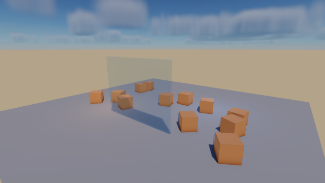</a> |

## pr-64 @ `b0ddfa52` — 2026-11-27 19:37 UTC

[CI run](https://github.com/tomerab1/quat-3d/actions/runs/46056455813) · ref `feat/r13-weather` · commit [`b0ddfa52`](https://github.com/tomerab1/quat-3d/commit/b0ddfa5276916d6133a43ef2aff02c1d90ce1526)

| Scene | Result | Image |
|---|---|---|
| `showcase-editor` — Showcase scene with the editor UI | ok (8 s) | <a href="runs/pr-64/b0ddfa52/showcase-editor.png">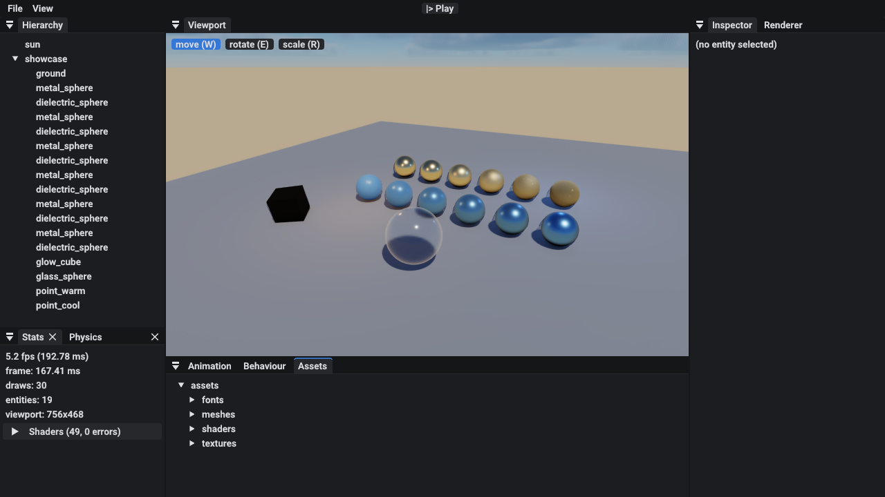</a> |
| `showcase` — Showcase scene, no UI | ok (11 s) |  |
| `terrain` — Showcase + GPU-generated terrain tile | ok (44 s) |  |
| `physics` — Physics demo (Jolt) after 90 frames | ok (36 s) |  |

## pr-74 @ `c56e1cb5` — 2026-11-27 19:18 UTC

[CI run](https://github.com/tomerab1/quat-3d/actions/runs/46053643136) · ref `feat/net-host-hardening` · commit [`c56e1cb5`](https://github.com/tomerab1/quat-3d/commit/c56e1cb5030bc8b0c903d12ab0d3bd0bc5853519)

| Scene | Result | Image |
|---|---|---|
| `showcase-editor` — Showcase scene with the editor UI | ok (10 s) |  |
| `showcase` — Showcase scene, no UI | ok (13 s) |  |
| `terrain` — Showcase + GPU-generated terrain tile | ok (52 s) |  |
| `physics` — Physics demo (Jolt) after 90 frames | ok (39 s) |  |

## master @ `a38bf74a` — 2026-11-27 19:14 UTC

[CI run](https://github.com/tomerab1/quat-3d/actions/runs/46053189781) · ref `master` · commit [`a38bf74a`](https://github.com/tomerab1/quat-3d/commit/a38bf74a784d5be4d933d878676fafb3c0651b3f)

| Scene | Result | Image |
|---|---|---|
| `showcase-editor` — Showcase scene with the editor UI | ok (9 s) |  |
| `showcase` — Showcase scene, no UI | ok (13 s) |  |
| `terrain` — Showcase + GPU-generated terrain tile | ok (52 s) |  |
| `physics` — Physics demo (Jolt) after 90 frames | ok (39 s) | <a href="runs/master/a38bf74a/physics.png">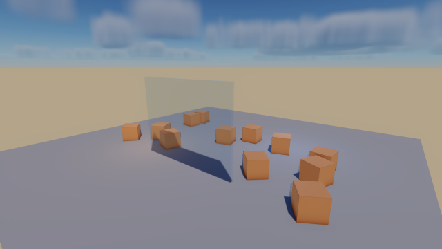</a> |

## pr-63 @ `0e79fab6` — 2026-11-27 18:55 UTC

[CI run](https://github.com/tomerab1/quat-3d/actions/runs/46050734340) · ref `feat/s-remote-hardening` · commit [`0e79fab6`](https://github.com/tomerab1/quat-3d/commit/0e79fab65fa79607dc510bf7250b5702d8b0103e)

| Scene | Result | Image |
|---|---|---|
| `showcase-editor` — Showcase scene with the editor UI | ok (9 s) |  |
| `showcase` — Showcase scene, no UI | ok (13 s) |  |
| `terrain` — Showcase + GPU-generated terrain tile | ok (53 s) |  |
| `physics` — Physics demo (Jolt) after 90 frames | ok (39 s) |  |

## master @ `90d71bac` — 2026-11-27 18:31 UTC

[CI run](https://github.com/tomerab1/quat-3d/actions/runs/46048724026) · ref `master` · commit [`90d71bac`](https://github.com/tomerab1/quat-3d/commit/90d71bacd68d11752a6615372cb77dc4764fa392)

| Scene | Result | Image |
|---|---|---|
| `showcase-editor` — Showcase scene with the editor UI | ok (7 s) |  |
| `showcase` — Showcase scene, no UI | ok (10 s) | <a href="runs/master/90d71bac/showcase.png">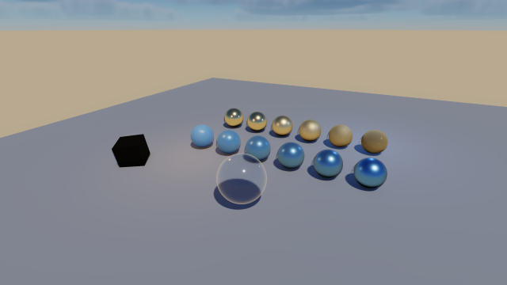</a> |
| `terrain` — Showcase + GPU-generated terrain tile | ok (41 s) |  |
| `physics` — Physics demo (Jolt) after 90 frames | ok (35 s) |  |

## pr-20 @ `cc38a6dd` — 2026-11-27 17:55 UTC

[CI run](https://github.com/tomerab1/quat-3d/actions/runs/46044059579) · ref `feat/ci-screenshots` · commit [`cc38a6dd`](https://github.com/tomerab1/quat-3d/commit/cc38a6dd69123bf92666cd7f2af3d392c72b0045)

| Scene | Result | Image |
|---|---|---|
| `showcase-editor` — Showcase scene with the editor UI | ok (7 s) |  |
| `showcase` — Showcase scene, no UI | ok (10 s) |  |
| `terrain` — Showcase + GPU-generated terrain tile | ok (42 s) | <a href="runs/pr-20/cc38a6dd/terrain.png">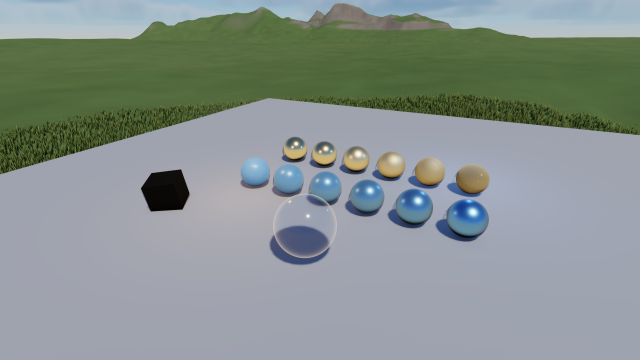</a> |
| `physics` — Physics demo (Jolt) after 90 frames | ok (35 s) |  |

## pr-20 @ `7c2dc231` — 2026-11-27 17:40 UTC

[CI run](https://github.com/tomerab1/quat-3d/actions/runs/46035726348) · ref `feat/ci-screenshots` · commit [`7c2dc231`](https://github.com/tomerab1/quat-3d/commit/7c2dc2315cf999a309b285e970a20137ed7683c3)

| Scene | Result | Image |
|---|---|---|
| `showcase-editor` — Showcase scene with the editor UI | ok (9 s) |  |
| `showcase` — Showcase scene, no UI | ok (12 s) |  |
| `terrain` — Showcase + GPU-generated terrain tile | ok (52 s) |  |
| `physics` — Physics demo (Jolt) after 90 frames | ok (39 s) |  |

## pr-49 @ `d1437d19` — 2026-11-27 15:46 UTC

[CI run](https://github.com/tomerab1/quat-3d/actions/runs/46024046487) · ref `feat/mountain-scene` · commit [`d1437d19`](https://github.com/tomerab1/quat-3d/commit/d1437d19bb1d016d4913da022fac9d8cb7ecdc25)

| Scene | Result | Image |
|---|---|---|
| `showcase-editor` — Showcase scene with the editor UI | ok (8 s) |  |
| `showcase` — Showcase scene, no UI | ok (11 s) |  |
| `terrain` — Showcase + GPU-generated terrain tile | ok (46 s) |  |
| `physics` — Physics demo (Jolt) after 90 frames | ok (37 s) |  |
| `mountain-forest` — Mountain + forest showcase: terrain, scattered trees and rocks, GPU grass | ok (38 s) |  |

## pr-20 @ `bdffb8b2` — 2026-11-27 14:39 UTC

[CI run](https://github.com/tomerab1/quat-3d/actions/runs/46015743378) · ref `feat/ci-screenshots` · commit [`bdffb8b2`](https://github.com/tomerab1/quat-3d/commit/bdffb8b20eaadea858a31487ea87a6ac28a61cd3)

| Scene | Result | Image |
|---|---|---|
| `showcase-editor` — Showcase scene with the editor UI | ok (7 s) |  |
| `showcase` — Showcase scene, no UI | ok (7 s) |  |
| `terrain` — Showcase + GPU-generated terrain tile | ok (33 s) |  |
| `physics` — Physics demo (Jolt) after 90 frames | ok (25 s) |  |

## pr-20 @ `98885f4e` — 2026-11-27 13:57 UTC

[CI run](https://github.com/tomerab1/quat-3d/actions/runs/46008005221) · ref `feat/ci-screenshots` · commit [`98885f4e`](https://github.com/tomerab1/quat-3d/commit/98885f4ed1af135ff95090025a9ec23463449b21)

| Scene | Result | Image |
|---|---|---|
| `showcase-editor` — Showcase scene with the editor UI | ok (8 s) |  |
| `showcase` — Showcase scene, no UI | ok (10 s) |  |
| `terrain` — Showcase + GPU-generated terrain tile | ok (46 s) |  |
| `physics` — Physics demo (Jolt) after 90 frames | ok (38 s) |  |

