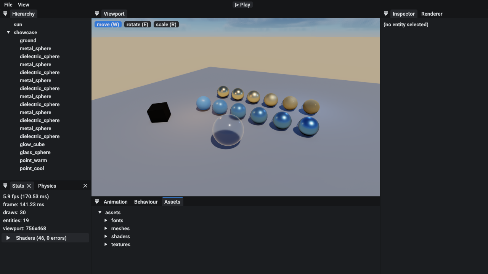
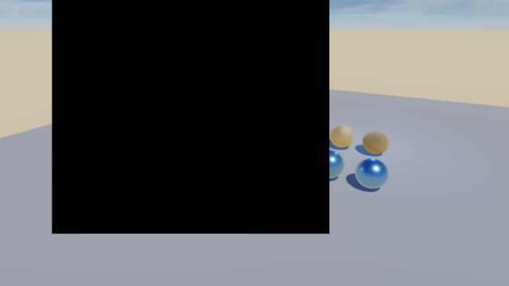
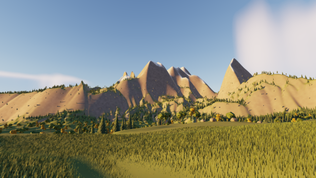
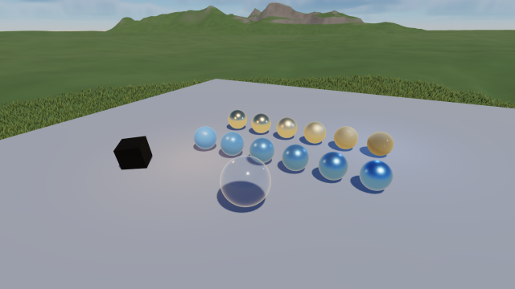

# CI screenshots

Rendered by the `linux` job of `.github/workflows/ci.yml` (lavapipe under
Xvfb, `scripts/ci-screenshots.sh`) for pushes and same-repository pull
requests, and committed here by `scripts/ci-publish-screenshots.sh`.
Newest first. Images live under `runs/<pr-N or branch>/<commit>/`.

## pr-64 @ `b0ddfa52` — 2026-11-27 19:37 UTC

[CI run](https://github.com/tomerab1/quat-3d/actions/runs/46056455813) · ref `feat/r13-weather` · commit [`b0ddfa52`](https://github.com/tomerab1/quat-3d/commit/b0ddfa5276916d6133a43ef2aff02c1d90ce1526)

| Scene | Result | Image |
|---|---|---|
| `showcase-editor` — Showcase scene with the editor UI | ok (8 s) |  |
| `showcase` — Showcase scene, no UI | ok (11 s) |  |
| `terrain` — Showcase + GPU-generated terrain tile | ok (44 s) |  |
| `physics` — Physics demo (Jolt) after 90 frames | ok (36 s) |  |

## pr-74 @ `c56e1cb5` — 2026-11-27 19:18 UTC

[CI run](https://github.com/tomerab1/quat-3d/actions/runs/46053643136) · ref `feat/net-host-hardening` · commit [`c56e1cb5`](https://github.com/tomerab1/quat-3d/commit/c56e1cb5030bc8b0c903d12ab0d3bd0bc5853519)

| Scene | Result | Image |
|---|---|---|
| `showcase-editor` — Showcase scene with the editor UI | ok (10 s) |  |
| `showcase` — Showcase scene, no UI | ok (13 s) |  |
| `terrain` — Showcase + GPU-generated terrain tile | ok (52 s) |  |
| `physics` — Physics demo (Jolt) after 90 frames | ok (39 s) |  |

## master @ `a38bf74a` — 2026-11-27 19:14 UTC

[CI run](https://github.com/tomerab1/quat-3d/actions/runs/46053189781) · ref `master` · commit [`a38bf74a`](https://github.com/tomerab1/quat-3d/commit/a38bf74a784d5be4d933d878676fafb3c0651b3f)

| Scene | Result | Image |
|---|---|---|
| `showcase-editor` — Showcase scene with the editor UI | ok (9 s) |  |
| `showcase` — Showcase scene, no UI | ok (13 s) |  |
| `terrain` — Showcase + GPU-generated terrain tile | ok (52 s) |  |
| `physics` — Physics demo (Jolt) after 90 frames | ok (39 s) |  |

## pr-63 @ `0e79fab6` — 2026-11-27 18:55 UTC

[CI run](https://github.com/tomerab1/quat-3d/actions/runs/46050734340) · ref `feat/s-remote-hardening` · commit [`0e79fab6`](https://github.com/tomerab1/quat-3d/commit/0e79fab65fa79607dc510bf7250b5702d8b0103e)

| Scene | Result | Image |
|---|---|---|
| `showcase-editor` — Showcase scene with the editor UI | ok (9 s) |  |
| `showcase` — Showcase scene, no UI | ok (13 s) |  |
| `terrain` — Showcase + GPU-generated terrain tile | ok (53 s) |  |
| `physics` — Physics demo (Jolt) after 90 frames | ok (39 s) |  |

## master @ `90d71bac` — 2026-11-27 18:31 UTC

[CI run](https://github.com/tomerab1/quat-3d/actions/runs/46048724026) · ref `master` · commit [`90d71bac`](https://github.com/tomerab1/quat-3d/commit/90d71bacd68d11752a6615372cb77dc4764fa392)

| Scene | Result | Image |
|---|---|---|
| `showcase-editor` — Showcase scene with the editor UI | ok (7 s) |  |
| `showcase` — Showcase scene, no UI | ok (10 s) |  |
| `terrain` — Showcase + GPU-generated terrain tile | ok (41 s) |  |
| `physics` — Physics demo (Jolt) after 90 frames | ok (35 s) |  |

## pr-20 @ `cc38a6dd` — 2026-11-27 17:55 UTC

[CI run](https://github.com/tomerab1/quat-3d/actions/runs/46044059579) · ref `feat/ci-screenshots` · commit [`cc38a6dd`](https://github.com/tomerab1/quat-3d/commit/cc38a6dd69123bf92666cd7f2af3d392c72b0045)

| Scene | Result | Image |
|---|---|---|
| `showcase-editor` — Showcase scene with the editor UI | ok (7 s) |  |
| `showcase` — Showcase scene, no UI | ok (10 s) |  |
| `terrain` — Showcase + GPU-generated terrain tile | ok (42 s) |  |
| `physics` — Physics demo (Jolt) after 90 frames | ok (35 s) |  |

## pr-20 @ `7c2dc231` — 2026-11-27 17:40 UTC

[CI run](https://github.com/tomerab1/quat-3d/actions/runs/46035726348) · ref `feat/ci-screenshots` · commit [`7c2dc231`](https://github.com/tomerab1/quat-3d/commit/7c2dc2315cf999a309b285e970a20137ed7683c3)

| Scene | Result | Image |
|---|---|---|
| `showcase-editor` — Showcase scene with the editor UI | ok (9 s) |  |
| `showcase` — Showcase scene, no UI | ok (12 s) |  |
| `terrain` — Showcase + GPU-generated terrain tile | ok (52 s) |  |
| `physics` — Physics demo (Jolt) after 90 frames | ok (39 s) |  |

## pr-49 @ `d1437d19` — 2026-11-27 15:46 UTC

[CI run](https://github.com/tomerab1/quat-3d/actions/runs/46024046487) · ref `feat/mountain-scene` · commit [`d1437d19`](https://github.com/tomerab1/quat-3d/commit/d1437d19bb1d016d4913da022fac9d8cb7ecdc25)

| Scene | Result | Image |
|---|---|---|
| `showcase-editor` — Showcase scene with the editor UI | ok (8 s) |  |
| `showcase` — Showcase scene, no UI | ok (11 s) |  |
| `terrain` — Showcase + GPU-generated terrain tile | ok (46 s) |  |
| `physics` — Physics demo (Jolt) after 90 frames | ok (37 s) |  |
| `mountain-forest` — Mountain + forest showcase: terrain, scattered trees and rocks, GPU grass | ok (38 s) |  |

## pr-20 @ `bdffb8b2` — 2026-11-27 14:39 UTC

[CI run](https://github.com/tomerab1/quat-3d/actions/runs/46015743378) · ref `feat/ci-screenshots` · commit [`bdffb8b2`](https://github.com/tomerab1/quat-3d/commit/bdffb8b20eaadea858a31487ea87a6ac28a61cd3)

| Scene | Result | Image |
|---|---|---|
| `showcase-editor` — Showcase scene with the editor UI | ok (7 s) |  |
| `showcase` — Showcase scene, no UI | ok (7 s) |  |
| `terrain` — Showcase + GPU-generated terrain tile | ok (33 s) |  |
| `physics` — Physics demo (Jolt) after 90 frames | ok (25 s) |  |

## pr-20 @ `98885f4e` — 2026-11-27 13:57 UTC

[CI run](https://github.com/tomerab1/quat-3d/actions/runs/46008005221) · ref `feat/ci-screenshots` · commit [`98885f4e`](https://github.com/tomerab1/quat-3d/commit/98885f4ed1af135ff95090025a9ec23463449b21)

| Scene | Result | Image |
|---|---|---|
| `showcase-editor` — Showcase scene with the editor UI | ok (8 s) |  |
| `showcase` — Showcase scene, no UI | ok (10 s) |  |
| `terrain` — Showcase + GPU-generated terrain tile | ok (46 s) |  |
| `physics` — Physics demo (Jolt) after 90 frames | ok (38 s) |  |

