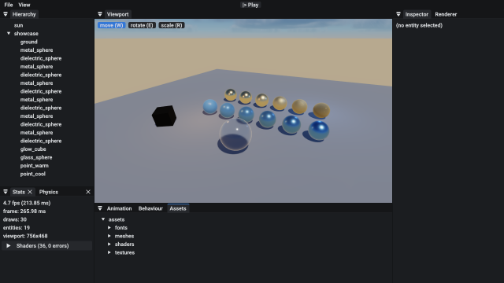
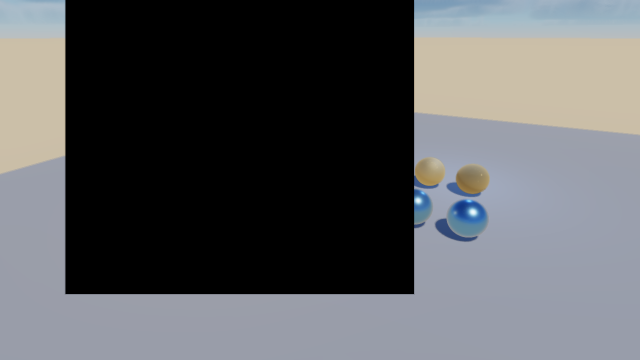

# CI screenshots

Rendered by the `linux` job of `.github/workflows/ci.yml` (lavapipe under
Xvfb, `scripts/ci-screenshots.sh`) for pushes and same-repository pull
requests, and committed here by `scripts/ci-publish-screenshots.sh`.
Newest first. Images live under `runs/<pr-N or branch>/<commit>/`.

## pr-20 @ `98885f4e` — 2026-11-27 13:57 UTC

[CI run](https://github.com/tomerab1/quat-3d/actions/runs/46008005221) · ref `feat/ci-screenshots` · commit [`98885f4e`](https://github.com/tomerab1/quat-3d/commit/98885f4ed1af135ff95090025a9ec23463449b21)

| Scene | Result | Image |
|---|---|---|
| `showcase-editor` — Showcase scene with the editor UI | ok (8 s) |  |
| `showcase` — Showcase scene, no UI | ok (10 s) |  |
| `terrain` — Showcase + GPU-generated terrain tile | ok (46 s) |  |
| `physics` — Physics demo (Jolt) after 90 frames | ok (38 s) |  |

